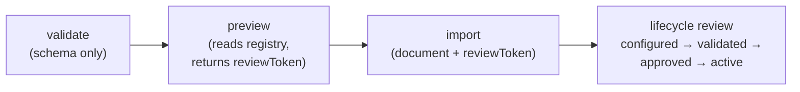

# Application manifests

An application manifest is one YAML or JSON document that describes how an
application appears in the portal: its identity, owner, launch behavior, the
client roles that gate access, and optional portal navigation. An administrator
validates and previews the document, then imports it. Import creates or updates
the application's entry in the portal system registry (`ihp_systems`) and its
access-role gate in one database transaction.

This page is the reference for writing a manifest and the procedure for importing
it. The behavior described here comes from
`backend/internal/features/rbac/manifest.go`, `manifest_handler.go` and
`manifest_postgres.go`, and from the portal panel in
`frontend/apps/shell/src/app/systems/components/application-manifest-panel.tsx`.

## When to use a manifest

The portal registry can be populated in four ways. They write the same
`ihp_systems` table but differ in who owns the definition.

| Method | Use it when | Starting lifecycle |
| --- | --- | --- |
| Application manifest (this page) | The application team keeps a versioned description of the application in its own repository, and an administrator imports it. CLIMS ships one in `infra/sso/clims.application.yaml`. | New entries start `registered` and disabled. |
| **Register application** on Admin → RBAC ([handbook](platform-onboarding.md)) | An administrator enters the metadata by hand, typically once. | `registered` and disabled. |
| Keycloak discovery (sync from Keycloak or a realm export, [RBAC and Keycloak sync](rbac-keycloak-sync.md)) | The registry should mirror existing Keycloak clients and their roles. | `active`, unless the client carries `portal.onboarding.profile`. |
| System RBAC seed (`system-rbac seed`, [System onboarding](system-onboarding.md)) | The definition belongs to the portal's own configuration in `backend/config/system-rbac.seed.yaml`, including role-to-permission mappings. | `active`, or `registered` when `enabled: false`. |

Choose a manifest when you want the launch, ownership and access gate to come
from one reviewed file. A manifest does not define role permissions, does not
assign roles to users, and does not touch Keycloak. Use the other tools for
those parts (see [What import does not do](#what-import-does-not-do)).

Once an application has been imported from a manifest, automatic startup seed
and startup Keycloak discovery skip it, so they do not overwrite its
configuration, roles or access gate. The one addition the startup seed still
makes is a missing `serviceOnly` role from the seed (for example
`clims/identity_sync`): a manifest can't declare service-only roles, and the
seed's service clients need them. Existing roles are never changed. Explicit administrator actions are not
skipped: edits on Admin → RBAC, an administrator-run Keycloak sync
(`POST /admin/rbac/sync/apply`) and seed import through
`POST /admin/rbac/import/apply` can still change the entry.
The next manifest preview then shows the difference as an `update`.

## Prerequisites

- A portal administrator account (the `isAdmin` flag) with all three permissions
  `rbac:read`, `rbac:write` and `rbac:roles:write`. Without them the
  **Import manifest** button is hidden and the API returns 403.
- The backend `ENVIRONMENT` setting of the target deployment (default
  `development`). The manifest's `spec.environment` must equal it exactly.
- The Keycloak client whose client ID equals `metadata.id`, with the roles
  listed in `spec.access.roles`. Import does not create these.
- For `internal` launch: the backend module named in `launch.module` must be
  compiled into the backend and enabled.
- For navigation `requiredPermissions`: each permission must already exist in the
  permission catalog with status `active`.
- The backend must use the Postgres RBAC repository. Otherwise preview and import
  return 503 `MANIFESTS_UNAVAILABLE`.

## Field reference

The decoder rejects unknown fields and duplicate keys, and accepts exactly one
document (a second `---` document is rejected). JSON is accepted because it is
valid YAML. The document must be 1 to 131,072 bytes (128 KiB).

### Top level

| Field | Type | Required | Rule |
| --- | --- | --- | --- |
| `apiVersion` | string | Yes | Exactly `portal.moh.go.ug/v1alpha1`. |
| `kind` | string | Yes | Exactly `Application`. |
| `metadata` | object | Yes | See below. |
| `spec` | object | Yes | See below. |

### `metadata`

| Field | Type | Required | Rule |
| --- | --- | --- | --- |
| `id` | string | Yes | Matches `^[a-z][a-z0-9-]{1,99}$`: 2–100 characters, lowercase letters, digits and dashes, starting with a letter. Becomes the registry client ID and must equal the Keycloak client ID. Underscores and dots are not allowed. |
| `name` | string | Yes | Non-blank. Becomes the display name (surrounding spaces are trimmed). |
| `version` | string | Yes | Full semantic version `MAJOR.MINOR.PATCH`, optionally prefixed with `v`, with optional pre-release or build suffix. No leading zeros (`01.0.0` is rejected). Stored in the manifest only; it is not a registry column. |
| `description` | string | No | Becomes the registry description. |

### `spec`

| Field | Type | Required | Rule |
| --- | --- | --- | --- |
| `environment` | string | Yes | Must equal the backend `ENVIRONMENT` value. |
| `owner.team` | string | Yes | Non-blank. |
| `owner.name` | string | Yes | Non-blank. |
| `owner.email` | string | Yes | A plain address such as `team@example.org`. A display-name form such as `Team <team@example.org>` is rejected. |
| `supportUrl` | string | Yes | URL rules below. |
| `icon` | string | No | Portal icon name. |
| `category` | string | No | Portal category label. |
| `launch` | object | Yes | See [Launch modes](#launch-modes). |
| `access.roles` | list of strings | Yes | 1–50 unique client role names of the `metadata.id` client. Each matches `^[a-z0-9][a-z0-9_.:-]{0,99}$`. A user needs any one of them. The list is sorted on import. |
| `navigation` | list | No | Up to 50 entries. Not allowed with `external` launch. See [Navigation entries](#navigation-entries). |

### URL rules

`spec.supportUrl`, `launch.url` and `launch.entryUrl` must be absolute URLs
with a host and:

- use `https`, except that `http` to `localhost`, `127.0.0.1` or `::1` is
  accepted when `ENVIRONMENT` is `development` or `test`;
- carry no user name or password, query string or fragment;
- contain no `*`, backslash or whitespace.

### Launch modes

`launch.mode` selects one of three shapes. Fields from another mode are
rejected.

| Mode | Required fields | Must be absent | Registry result |
| --- | --- | --- | --- |
| `external` | `url` (URL rules) | `route`, `module`, `appName`, `entryUrl`, and `spec.navigation` | `systemType: external`, `integrationType: external`, `launchMode: new_tab`, `launchUrl` = `url`. Launcher tile only; opens in a new tab. |
| `internal` | `route`, `module` | `url`, `appName`, `entryUrl` | `systemType: platform`, `integrationType: hosted_module`, `launchMode: internal`, `launchUrl` = `route`. |
| `microfrontend` | `route`, `appName`, `entryUrl` | `url`, `module` | Same as `internal`, with `launchUrl` = `route`. The shell loads `entryUrl` as a single-spa application. |

Additional rules:

- `route` (internal and microfrontend) must be a canonical portal path: it starts
  with `/apps/` or `/portal/`, is unchanged by path cleaning (no `..`, `//` or
  trailing `/`), and contains no `%`, `?`, `#`, backslash or whitespace.
- `module` (internal) must be the ID of a backend module that is compiled in and
  enabled in this deployment.
- `route` (microfrontend) must be exactly `/apps/extensions/<metadata.id>`.
- `appName` (microfrontend) must match `^@[a-z0-9-]+/[a-z0-9-]+$`, must not use
  the `@moh-sso/` scope, and must not already be used by another manifest
  application (checked at preview).
- `entryUrl` (microfrontend) must serve a browser ES module that exports
  `bootstrap`, `mount` and `unmount`, with CORS for cross-origin hosting. The
  shell refuses to mount a module that lacks any of the three.

### Navigation entries

| Field | Type | Required | Rule |
| --- | --- | --- | --- |
| `id` | string | Yes | Non-blank and unique within the manifest. |
| `label` | string | Yes | Non-blank. |
| `path` | string | Yes | Canonical portal path (same rule as `route`). For `microfrontend`, it must equal the route or sit below it (`<route>/...`). |
| `icon` | string | No | Portal icon name. |
| `requiredPermissions` | list of strings | No | Each value non-blank, and an existing `active` permission key (checked at preview, not by `/validate`). Controls the entry's visibility in addition to the access-role gate. |

### Values the manifest sets for you

These registry fields are not manifest fields. Import sets them as follows.

| Registry field | Value |
| --- | --- |
| `displayInLauncher` | Always `true`. |
| `displayInSideNav` | `true` when `spec.navigation` has entries, otherwise `false`. |
| `enabled` | Always written as `false`. |
| `contractVersion` | `1`. |
| `environment` | The deployment's `ENVIRONMENT`. |
| `navigation` | The `spec.navigation` list as JSON, or empty when absent. |
| `authenticatedLaunchUrl`, `sortOrder` | Kept from the existing entry on update; empty/zero on create. |
| `documentationUrl`, `criticality` | Not settable from a manifest. An update writes them empty, clearing any value set on Admin → RBAC. |

The whole manifest is also stored in the entry's metadata under
`applicationManifest`.

## Workflow



### 1. Validate (optional)

`POST /admin/rbac/application-manifests/validate` parses the document and runs
the field rules above. It does not read the database, so it does not check
existing roles, navigation permissions or microfrontend name clashes. It returns
the normalized manifest (roles sorted, empty lists removed). The portal panel
does not call this endpoint; its **Validate and preview** button calls preview,
which runs the same validation first.

### 2. Preview

`POST /admin/rbac/application-manifests/preview` validates the document, reads
the current registry entry in a read-only transaction and returns:

| Field | Meaning |
| --- | --- |
| `manifest` | The normalized manifest. |
| `operation` | `create` (no entry for `metadata.id`), `update`, or `noop` (the stored manifest, access roles and registry fields already match and no roles need creating). |
| `before` | The current entry with its roles and access roles. Absent on `create`. |
| `after` | The registry values the import will write. |
| `rolesToCreate` | Access roles that have no local system role yet. Import creates them. |
| `accessRoles` | The access-role gate after import. |
| `warnings` | Always: "Registration follows the application lifecycle review before activation." and "Client roles must exist in Keycloak and be assigned through the existing access administration." For microfrontends also: "The entry URL must serve browser ES modules with CORS and single-spa lifecycle exports." |
| `reviewToken` | A SHA-256 digest of this preview plus the entry's stored metadata and last update time. |

Preview also fails with 400 when an access role exists locally but is disabled,
when a navigation permission is unknown or inactive, or when another application
already uses the microfrontend `appName`.

The review token has no expiry time. It stays valid until anything it covers
changes: the document, the registry entry (any edit updates its timestamp), its
roles or its access roles. Then import returns 409 and you must preview again.

### 3. Import

`POST /admin/rbac/application-manifests/import` takes the same document plus the
`reviewToken`. It takes a per-application advisory lock, recomputes the preview
in a serializable transaction and:

- returns 409 `MANIFEST_REVIEW_REQUIRED` when the token is missing or no longer
  matches. When the recomputed operation is `noop`, any non-empty token is
  accepted and nothing is written.
- refuses an `update` when the existing entry is enabled, or is `retired`:
  "suspend the existing application before changing its manifest; retired
  applications cannot be updated".
- otherwise writes, in one transaction:
  1. the registry entry (insert or update) with the `after` values and
     `enabled = false`;
  2. a local system role for each name in `rolesToCreate` (display name equals
     the role name, no permissions);
  3. the access-role gate, replaced by exactly `spec.access.roles`;
  4. the manifest into the entry's metadata (`applicationManifest`) and the
     navigation JSON;
  5. audit events (below).

Any failure rolls back the whole import. Concurrent imports of the same
application serialize; a loser gets 409. The response body is the preview that
was applied.

Import is rate limited by the RBAC sensitive-write policy (20 requests per
minute per user).

### 4. Lifecycle after import

| Before import | After import |
| --- | --- |
| No entry | `registered`, disabled, lifecycle-managed. |
| `registered`, `configured` or `suspended` | Status unchanged, disabled. |
| `validated`, `approved`, or `active` but disabled | A configuration change returns it to `configured` and records `system.lifecycle.invalidated`. |
| `active` and enabled | Update refused. Suspend it first. An identical document (`noop`) still succeeds. |
| `retired` | Update refused. |

Then advance the application through configured, validated, approved and active
on Admin → RBAC. The transitions, required permissions and validation checks are
in [Platform development](platform-development.md#lifecycle-and-permissions).
Activation needs at least one access role backed by an enabled system role; the
roles created by import satisfy this.

### Re-import and idempotence

- Importing the same document again returns `noop` and writes nothing, including
  a retry after a lost response.
- To change an application, edit the manifest (for example bump
  `metadata.version`), suspend the application if it is active, preview and
  import. After import it needs the lifecycle review again.
- Removing a role from `spec.access.roles` removes it from the access gate. The
  local system role and its permissions remain.
- Removing `spec.navigation` clears the navigation and turns off side navigation.
- Existing role-to-permission mappings are never changed by import.

### Audit records

Each import that writes records, in the same transaction:

| Action | Details |
| --- | --- |
| `system.upserted` | The registry entry as written. |
| `application.manifest.imported` | The full normalized manifest. Resource type `system`, with the importing user as actor. |
| `system.lifecycle.invalidated` | Only when an entry in `validated`, `approved` or `active` is returned to `configured`. |

Validate and preview write no RBAC audit records. Read them on Admin → Audits or
`GET /admin/rbac/audit`.

## What import does not do

- It does not create or change Keycloak clients, client roles, redirect URIs or
  credentials. Create the client and roles first (see
  [System onboarding](system-onboarding.md#1-create-or-confirm-the-keycloak-client)).
- It does not assign roles to users or groups. Use user access administration or
  [RBAC groups](rbac-groups.md).
- It does not map permissions to roles. Use Admin → RBAC or the seed.
- It does not enable or activate the application.
- It does not deploy the application or probe its URLs.

## Importing in the portal

1. Open **Admin → Systems** (`/portal/admin/systems`).
2. Click **Import manifest** in the table toolbar. The **Import application
   manifest** panel opens.
3. Choose a `.yaml`, `.yml` or `.json` file with **YAML or JSON manifest**, or
   paste the text into **Manifest document**. Files over 128 KiB are refused in
   the browser.
4. Click **Validate and preview**. Errors appear in a **Manifest request failed**
   notification.
5. Review the preview: the heading **Proposed create**, **Proposed update** or
   **Proposed unchanged registration**; the name, version and environment; the
   access roles; **Local role definitions to create**; the warnings; and the
   **Current registration** and **Proposed registration** JSON.
6. Tick **I reviewed the application, environment, URLs and access roles.**
7. Click **Import reviewed manifest**. On success the panel shows **Manifest
   imported**.

Editing the document after a preview discards the preview and the tick. If
import fails, the preview is discarded; preview again.

## Importing with the API

Paths are relative to `/api/v1`. Send a bearer token or the `sso_session` cookie
of an administrator with the permissions above. The manifest goes in the
`document` string field. The request body is limited to 1 MiB and the document to
128 KiB.

```sh
BASE=http://localhost:9000/api/v1
TOKEN=<admin access token>
BODY=$(jq -Rs '{document: .}' clims.application.yaml)

# Optional schema check
curl -sS -X POST "$BASE/admin/rbac/application-manifests/validate" \
  -H "Authorization: Bearer $TOKEN" -H 'Content-Type: application/json' \
  -d "$BODY"

# Preview and keep the token
PREVIEW=$(curl -sS -X POST "$BASE/admin/rbac/application-manifests/preview" \
  -H "Authorization: Bearer $TOKEN" -H 'Content-Type: application/json' \
  -d "$BODY")
echo "$PREVIEW" | jq '.data | {operation, rolesToCreate, accessRoles, warnings, after}'
REVIEW_TOKEN=$(echo "$PREVIEW" | jq -r '.data.reviewToken')

# Import the reviewed document
curl -sS -X POST "$BASE/admin/rbac/application-manifests/import" \
  -H "Authorization: Bearer $TOKEN" -H 'Content-Type: application/json' \
  -d "$(jq -Rs --arg token "$REVIEW_TOKEN" '{document: ., reviewToken: $token}' clims.application.yaml)"
```

Responses use the standard envelope (`{"success": true, "data": ...}` or
`{"success": false, "error": {"code", "message"}}`).

`GET /applications/:clientId/manifest` returns `id`, `name`, `version` and
`launch` for the shell's microfrontend route. It answers only when the
application is active and enabled, its launch URL still equals the manifest's
`url` or `route`, and the caller has `systems:launch` and access to the
application (or is an administrator).

## Examples

`examples/manifests/` holds three starting points. Their example.org URLs,
owners and roles are placeholders, and all use `environment: development`.

| File | Mode | Shows |
| --- | --- | --- |
| [`external.yaml`](../examples/manifests/external.yaml) | `external` | `health-bi` launched in a new tab, gated by `report_viewer`. |
| [`internal.yaml`](../examples/manifests/internal.yaml) | `internal` | `portal-metrics` on `/portal/admin/home`, tied to the `metrics` module, with a navigation entry requiring `metrics:read`. |
| [`microfrontend.yaml`](../examples/manifests/microfrontend.yaml) | `microfrontend` | `example-reports` at `/apps/extensions/example-reports` with `appName` `@moh-extensions/example-reports`. |

The backend tests parse all three, so they stay valid against the current
validator.

### CLIMS (external application)

The CLIMS repository ships `infra/sso/clims.application.yaml`:

```yaml
apiVersion: portal.moh.go.ug/v1alpha1
kind: Application
metadata:
  id: clims
  name: CLIMS
  version: 2.1.0
  description: Laboratory orders, specimens and results
spec:
  environment: development
  owner:
    team: CLIMS
    name: CLIMS administrator
    email: clims@example.org
  supportUrl: https://clims.example.org/support
  category: Laboratory
  launch:
    mode: external
    url: https://clims.example.org/api/v1/auth/sso/start
  access:
    roles: [clims_access]
```

- `metadata.id` `clims` matches the CLIMS Keycloak client.
- `launch.url` points at CLIMS's own SSO start endpoint, so the launcher tile
  opens CLIMS in a new tab and CLIMS runs the OIDC sign-in itself.
- `access.roles` `[clims_access]` is the access role the identity sync grants and
  removes ([Connected applications](integrations/connected-applications.md)).
- External mode allows no `navigation`.

Before importing, replace `environment`, the owner, `supportUrl` and
`launch.url` with the target deployment's values. The CLIMS `infra/sso/README.md`
says these values are placeholders. On a fresh registry the preview shows
**Proposed create** with `clims_access` under local role definitions to create.

POES does not ship a manifest in `infra/sso/`. Register it with **Register
application** or Keycloak discovery, or write a manifest modelled on the CLIMS one
(`id: poesgo`, `roles: [poesgo_access]`).

## Errors and fixes

Validation and preview errors return 400 `INVALID_INPUT` with the message
prefixed by `invalid input: `.

| Message | Fix |
| --- | --- |
| `manifest must contain 1–131072 bytes` | Send a non-empty document of at most 128 KiB. |
| `invalid manifest: yaml: ...` | YAML syntax error, an unknown field (`field x not found in type ...`), a duplicate key (`mapping key "x" already defined`), or a wrong type. Fix the named line. |
| `provide exactly one application manifest` | Remove the extra `---` documents. |
| `unsupported apiVersion or kind` | Use `apiVersion: portal.moh.go.ug/v1alpha1` and `kind: Application`. |
| `metadata requires a lowercase ID and a display name` | Use a 2–100 character ID of lowercase letters, digits and dashes starting with a letter, and a non-blank `name`. |
| `metadata.version requires a full semantic version` | Use `MAJOR.MINOR.PATCH`, for example `1.0.0`, without leading zeros. |
| `manifest environment must match this deployment` | Set `spec.environment` to the backend's `ENVIRONMENT` value. |
| `owner team and name are required` | Fill `owner.team` and `owner.name`. |
| `owner email must be an email address` | Use a bare address without a display name. |
| `supportUrl: ...`, `launch.url: ...`, `launch.entryUrl: ...` | Use an absolute HTTPS URL without credentials, query or fragment. Loopback HTTP is allowed only in `development` and `test`. |
| `access.roles requires 1–50 client role names` | List between 1 and 50 roles. |
| `access.roles contains an invalid or duplicate role` | Use lowercase names starting with a letter or digit, using only `a-z 0-9 _ . : -`, each once. |
| `external launch accepts a URL and no portal navigation or module fields` | Remove `route`, `module`, `appName`, `entryUrl` and `spec.navigation`. |
| `internal launch requires a portal route and a compiled module` | Set a canonical `/apps/...` or `/portal/...` route and remove `url`, `appName` and `entryUrl`. |
| `launch.module must identify an enabled compiled backend module` | Use the ID of a module compiled into and enabled in this backend. |
| `microfrontend requires a unique scoped appName and route /apps/extensions/<metadata.id>` | Set `route` to `/apps/extensions/<metadata.id>`, use a scoped `appName` outside `@moh-sso/`, and remove `url` and `module`. |
| `launch.mode must be external, internal or microfrontend` | Fix `launch.mode`. |
| `navigation is limited to 50 entries` | Reduce `spec.navigation`. |
| `navigation paths must be canonical portal paths` | Use `/apps/...` or `/portal/...` paths without `..`, trailing `/`, `%`, `?` or `#`. |
| `microfrontend navigation must remain within its application route` | Keep each path at or below `/apps/extensions/<metadata.id>`. |
| `navigation item N has an empty id`, `navigation item id "x" is duplicated`, `navigation item "x" has an empty label`, `navigation item "x" has an empty requiredPermissions value` | Give every entry a unique `id`, a `label` and non-blank permissions. |
| `access role "x" is disabled` (preview) | Re-enable the system role on Admin → RBAC or remove it from the manifest. |
| `unknown navigation permission "x"` (preview) | Register or reactivate the permission, or remove it. |
| `microfrontend appName is already registered` (preview) | Choose an `appName` not used by another application. |
| `suspend the existing application before changing its manifest; retired applications cannot be updated` (import) | Suspend the application on Admin → RBAC, preview again and import. Retired applications cannot be changed. |

Other responses:

| Status and code | Cause |
| --- | --- |
| 400 `INVALID_MANIFEST` "Provide a manifest document of at most 128 KiB" | The JSON body is malformed, has no `document`, or exceeds 1 MiB. |
| 403 `FORBIDDEN` | Not an administrator, or missing one of the three permissions. |
| 409 `MANIFEST_REVIEW_REQUIRED` | The review token is missing or stale. Preview again. |
| 429 `RATE_LIMIT_EXCEEDED` | Import rate limit reached. |
| 503 `MANIFESTS_UNAVAILABLE` | Manifest storage requires the Postgres repository. |

## Related

- [System onboarding](system-onboarding.md): Keycloak client, seed and navigation model.
- [Application and system onboarding handbook](platform-onboarding.md): the full UI walkthrough.
- [Connected applications](integrations/connected-applications.md): CLIMS and POES.
- [RBAC usage](rbac-usage.md) and [API reference](api-reference.md#rbac-governance).
- [`examples/manifests/README.md`](../examples/manifests/README.md).
