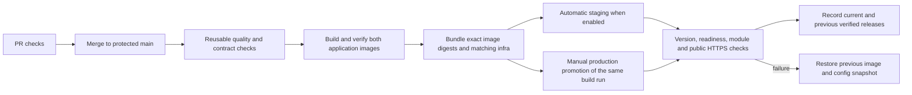

# Continuous delivery and server setup

## Pipeline and responsibility boundaries



| Action | Owner / workflow | What happens |
| --- | --- | --- |
| Validate source | PR Quality Checks, reused by image build | Backend/frontend checks, API freshness, infrastructure/CD tests. |
| Publish images | `build.yml` | Build image pair from one main commit, verify runtime metadata, retain registry digests. Tag pushes still publish component images separately. |
| Package release | Final job in `build.yml` | Upload `deployment-bundle`: image manifest, deployment archive and SHA-256 checksum. No runtime secrets, certificates or private env files. |
| Prepare deployment | `deploy-to-server.yaml` prepare job | Validate the producing workflow/repository/main commit, archive contents and manifest; publish a reviewable plan. No server credentials used. |
| Deploy staging | Same workflow, staging environment | Automatic after a successful main image build only when `AUTO_DEPLOY_STAGING=true`; can also be dispatched manually. |
| Promote production | Same workflow, manual dispatch | Select an already successful main build run and production. Environment protection controls when its deploy job can run. No image rebuild. |
| Restore previous release | Automatic on rollout failure, or `rollback-server.yml` | Restore the previous recorded infrastructure/env snapshot and application digests, then verify. Database changes are not reversed. |
| Configure server/proxy | Operator, one time | Install Docker/SSH, fill server-local settings, registry access, backups, Nginx/TLS, DNS and firewall rules. Not repeated by image builds. |

Backend release/notes workflows no longer independently trigger deployment. CD
waits for the complete paired-image bundle, removing the backend/frontend build
race. Only successful `push` builds from this repository's `main` branch are
accepted; PR/fork artifacts and arbitrary tags are rejected. See GitHub's
[workflow-run security guidance](https://docs.github.com/en/actions/reference/workflows-and-actions/events-that-trigger-workflows#workflow_run).

## 1. Prepare each application server

Use separate Docker hosts for staging and production. The current production
Compose project and container names are fixed, so separate directories on one
Docker daemon do not isolate the environments. Main images currently target
Linux amd64; enable matching multi-architecture publishing before using arm64.

Use a supported Linux server, for example Ubuntu 24.04 amd64, with:

- Docker Engine and Compose plugin 2.24.4+ from the [official installation instructions](https://docs.docker.com/engine/install/ubuntu/).
- Python 3.9+, OpenSSH server/client, CA certificates and outbound HTTPS/DNS.
- Disk space for old/new images, PostgreSQL/uploads and deployment snapshots.
- Access to external Keycloak, upload-management DB, warehouse, SMTP and other enabled providers.
- An SSH route from the deployment runner. For private-only hosts, configure a dedicated network-connected runner using `DEPLOY_RUNNER_LABELS`; hosted GitHub runners cannot route directly to a private IP.

On Ubuntu, after installing Docker from its documented repository:

```bash
sudo apt-get update
sudo apt-get install -y python3 openssh-server ca-certificates curl jq gzip
sudo systemctl enable --now docker
```

From a reviewed checkout on your workstation, prepare the public setup files:

```bash
tar -czf /tmp/moh-server-setup.tar.gz infra/server infra/env/*.example infra/nginx
scp /tmp/moh-server-setup.tar.gz admin@APP_SERVER:/tmp/
```

Create a dedicated deployment key on your workstation and copy only its public
key to the server (use different keys for staging and production):

```bash
ssh-keygen -t ed25519 -N '' -f "$HOME/.ssh/moh-cd-production" -C moh-cd-production
scp "$HOME/.ssh/moh-cd-production.pub" admin@APP_SERVER:/tmp/moh-deploy.pub
```

On the application server as the administrator:

```bash
mkdir -p /tmp/moh-server-setup
tar -xzf /tmp/moh-server-setup.tar.gz -C /tmp/moh-server-setup
sudo DEPLOY_PUBLIC_KEY_FILE=/tmp/moh-deploy.pub \
  bash /tmp/moh-server-setup/infra/server/bootstrap.sh
```

Defaults: user `mohdeploy`, root `/opt/moh-sso`. Override `DEPLOY_USER` and
`DEPLOY_ROOT` when running bootstrap if needed. Existing configs/authorized keys
are retained. Docker-group membership permits host administration; reserve this
account/key for protected deployment jobs. Start a fresh login to use its group.
The script does not install Docker, modify public Nginx/TLS, or fill credentials.

Optionally install `infra/server/sshd-mohdeploy.conf.example` as an SSH drop-in,
matching the chosen username. Validate with `sudo sshd -t` before reloading SSH.
Keep existing operator access. Verify the server's host-key fingerprint from its
console (`sudo ssh-keygen -lf /etc/ssh/ssh_host_ed25519_key.pub`) before trusting
its corresponding known-host entry in GitHub. Do not blindly trust a key scan.

## 2. Fill persistent server-local configuration

| File/directory | Required contents |
| --- | --- |
| `/etc/moh-sso/deploy.json` | Paths, `mode`, public HTTPS origin, timeouts, optional backup hook. Match `deploy_root` with the GitHub `DEPLOY_ROOT` variable. |
| `/etc/moh-sso/prod.env` | Production runtime settings from the example; DB user/name, Redis password, public URLs, external DB/DWH/DQA/provider credentials and signing key. |
| `/etc/moh-sso/remote-proxy.env` | Required for `mode=remote`: real `APP_BIND_ADDRESS` private/VPN IPv4 owned by the application server. |
| `/etc/moh-sso/secrets/db_password.txt` | Primary database credential. |
| `/etc/moh-sso/secrets/keycloak_admin_client_secret.txt` | Keycloak service-account client secret. |
| `/etc/moh-sso/secrets/keycloak_web_client_secret.txt` | Browser-login client secret. |
| `/etc/moh-sso/trusted-proxies.conf` | Used only for `mode=gateway`; exact trusted HTTPS proxy addresses. Overrides the bundled default mount. |
| `/opt/moh-sso/incoming` | Uploaded public release bundles and extraction helpers. |
| `/opt/moh-sso/releases` | Versioned public deployment infrastructure, one directory per build. |
| `/opt/moh-sso/state` | Restricted runtime env snapshots, lock, current/previous deployment records, pending recovery state and audit history. |
| `/var/backups/moh-sso` | Optional local DB backup destination. |

All private config/secret files should be owned by the deploy account with mode
0600; directories are 0750. Edit placeholders before the first deployment. Keep
`APP_ENV_FILE` in the env example unchanged if present: CD overrides its path with
a private snapshot. Manifest tags/digests override env-file release tags; do not
edit tags to select a CD release. Image bytes are selected by digest.

Select one topology in `deploy.json`:

- `prod`: host Nginx reaches localhost ports 3000/9000.
- `remote`: Nginx on another machine reaches only the application's private IP.
- `gateway`: container gateway exposes its configured listener; applications have no host ports.

Use a valid `public_base_url` for that environment, e.g. a staging domain on the
staging host. Keep `verify_public_edge=true` after TLS/DNS/proxy setup; redirects,
readiness, Swagger and the API version are checked there. Configured backend and
frontend versions/commits are checked inside the application network as well.
Read [deployment configuration](deployment.md) for runtime setting details.

Log in to GHCR as the deployment account, not root, if packages are private:

```bash
sudo -iu mohdeploy
# Supply a read:packages credential through stdin; do not put it in the repository.
docker login ghcr.io -u REGISTRY_READER --password-stdin
```

Use the same account/home for deployments so Docker can find its registry login.
The GitHub deploy job does not upload application or registry credentials.

## 3. Configure Nginx, DNS, network and SSO separately

On the proxy machine, install the host snippets from `infra/nginx/host/`. For
remote Nginx replace its upstream file with `infra/nginx/remote/http.conf` and set
both example application IPs. Include the HTTP-context and portal-location files
inside the existing HTTPS site. Preserve Report Browser's `/` and `/report-browser/`
ownership. Provision the environment's certificate and HTTPS redirect there.

For gateway mode, preserve `/portal/` and `/ssobackend/` when forwarding to the
gateway and configure the server-local trusted-proxy file in both places. Public
DNS points at the HTTPS proxy. Allow application ports 3000/9000 only from that
proxy's actual private source IP; account for Docker's forwarded traffic. Keep
private HTTP hops inside a private/VPN network. None of these proxy/firewall
changes are silently applied during an application rollout.

Set Keycloak's exact web-client callback to the environment's
`https://PUBLIC_DOMAIN/ssobackend/api/v1/auth/callback`; match `LOGIN_URL`,
`FRONTEND_BASE_URL`, allowed return origins and cookie domain in the server env.
Backend-to-Keycloak and database URLs must be reachable from the application host.
Test TLS/DNS and direct private upstream connectivity before the first rollout.

## 4. Configure GitHub once

Create **staging** and **production** environments in repository Settings.
Configure [environment protection](https://docs.github.com/en/actions/concepts/workflows-and-actions/deployment-environments), including required production reviewers where supported and allowed branches
restricted to `main`. Protect `main` with required quality/contract/infrastructure
checks and PR review. Protect workflow/CD changes through repository review rules.

Per-environment secrets:

| Secret | Value |
| --- | --- |
| `SSH_PRIVATE_KEY` | Private key paired with the deploy account's authorized public key. |
| `SSH_KNOWN_HOSTS` | Verified known-host lines for the actual host/port, including the port bracket form for nonstandard SSH ports. |

Per-environment variables:

| Variable | Default / value |
| --- | --- |
| `DEPLOY_HOST` | Required reachable SSH DNS name or management IP. |
| `DEPLOY_USER` | `mohdeploy` |
| `DEPLOY_PORT` | `22` |
| `DEPLOY_ROOT` | `/opt/moh-sso` |
| `DEPLOY_CONFIG` | `/etc/moh-sso/deploy.json` |

Repository variables:

| Variable | Purpose |
| --- | --- |
| `AUTO_DEPLOY_STAGING` | Set literal `true` after staging setup to enable automatic successful-main-build deployment. Default is disabled. |
| `DEPLOY_RUNNER_LABELS` | Optional JSON array; default `["ubuntu-latest"]`. For private-network deployment/rollback use e.g. `["self-hosted","linux","moh-deploy"]` on a dedicated connected runner. Prepare/build jobs remain hosted. |

The old `SERVER_IP`, `SSH_USER`, `DEPLOY_FOLDER`, `DEPLOY_COMPOSE_ENV`, expected
version/commit dispatch inputs and server-side `restart` script are replaced by
these settings and the verified manifest. Application credentials stay on the
server. The build uses `GITHUB_TOKEN` with `packages:write`; enable repository
package publication and give the registry reader access to both image packages.
No deployment SSH secrets are needed by build or prepare jobs.

## 5. Perform deployment actions

1. Merge the reviewed source/config change to `main`.
2. Wait for **Build & Push Images** to pass quality gates, publish both images,
   verify them and upload `deployment-bundle`. Record that workflow run ID.
3. If automatic staging is enabled, **Deploy Verified Image Bundle** runs for
   staging. Otherwise dispatch it manually with that build run ID and `staging`.
4. Review the deployment-plan job summary and staging behavior.
5. Dispatch the same deploy workflow with the **same build run ID** and
   `production`; satisfy the configured production environment protection.
6. Review its deployment-outcome artifact and server history. No images are rebuilt
   during promotion. Do not redeploy by selecting a mutable registry tag.

The deploy job separately configures SSH, uploads/verifies the archive, preflights
the server, and runs the locked transaction. It snapshots runtime settings,
validates Compose, pulls exact digests, verifies OCI version/commit labels,
runs the optional pre-deploy hook, reconciles containers with `--wait`, checks
runtime metadata/modules/public HTTPS, then records the verified release.

Release artifacts are retained for 30 days by default. Promote/download/archive a
bundle before expiry if long-term promotion is required. Existing server releases
remain available for rollback after GitHub artifact expiry. Bundles have no source
checkout or Git credentials requirement on the server.

## 6. Backups and rollback

Install and test a backup hook before routine production updates. The provided
`backup-primary.sh.example` is only for the bundled primary Postgres; install it
at `/etc/moh-sso/backup-primary.sh` with mode 0700 and set `pre_deploy_hook` in
`deploy.json`. Configure external-primary, upload/DWH and upload-storage backups
separately. A hook failure blocks rollout before the new API can migrate data.
For first bootstrap, provision the DB/backup procedure before enabling the hook;
it expects an existing database container.

On failed rollout, CD restores the previous recorded image pair **and** its
infrastructure/env snapshot, then verifies it. The first managed deployment has
no verified previous release, including when adopting existing containers; back
up that installation and retain its previous configuration/images before adoption.
Its first failure is reported without claiming rollback.
Database schema/data and external secret rotation are not reverted. Review
migration compatibility and test restore procedures independently.

For a deliberate revert, run **Roll Back Verified Deployment** for the selected
environment. It uses the same protected environment and concurrency group as CD.
Or, as the deploy user on the server:

```bash
python3 /opt/moh-sso/current/infra/scripts/cd_server.py status
python3 /opt/moh-sso/current/infra/scripts/cd_server.py verify
python3 /opt/moh-sso/current/infra/scripts/cd_server.py rollback --actor operator
```

The scripts default to `/etc/moh-sso/deploy.json`; pass `--config` for a custom path.
When a rollout/rollback process is killed or rollback fails, `state/pending.json`
blocks a new deployment until operator rollback recovers the previous verified
release. The rollback workflow uploads its recovery helper, so recovery of a
previously verified installation works even when the candidate was never activated.
Keep `current`, the previous
release directory, their env snapshots, and corresponding images. Do not prune
those resources during rollback retention. Audit history is `state/history.jsonl`.
Credential snapshots are private; do not upload the state directory as an artifact.

An interrupted **first installation** has no previous release to restore. Inspect
`state/pending.json` and container status as the deploy account. After confirming
its `previous` field is null and no deploy process is running, retain that pending
file under another filename for investigation, then retry the same deployment
bundle. Existing database/upload volumes remain in place. Ordinary recovery of
an installation with a verified previous release uses the rollback action above.

## Local preparation and validation

```bash
make cd-check                 # bundle security and deployment transaction tests
make infra-check              # CD plus Compose/environment contracts
make cd-preflight DEPLOY_CONFIG=/etc/moh-sso/deploy.json   # on a prepared server
make cd-status DEPLOY_CONFIG=/etc/moh-sso/deploy.json
```

`cd-verify` and `cd-rollback` are also available in the root/infra Makefiles.
Tests do not access a server, publish images, set GitHub secrets or deploy live
services. Real SSH, registry permissions, firewall/TLS/DNS and a staging rollout
must be verified after adding the actual environment values.
