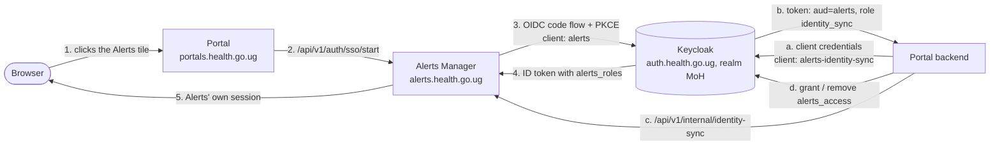

# Connecting Alerts Manager to the portal

This page is the integration plan for **Alerts Manager** (registry ID `alerts`), an
application that keeps its own user accounts. It takes Alerts from nothing to people
opening it from the Integrated Health Portal with their existing sign-in, with their
Alerts accounts linked and their access managed from the portal.

It is a worked instance of [Onboarding a client application](client-onboarding.md),
filled in with Alerts' identifiers and the production values for
`portals.health.go.ug`. That guide stays the reference for exact rules; this page says
who does what, in which order, and what to check at each step. CLIMS is the reference
implementation for everything here.

Values marked **proposed** need agreement with the Alerts team before anyone builds or
configures anything (step 1).

## 1. What "connected" means



Two connections, both required:

- **Sign-in (1–5).** The tile opens Alerts, which runs its own OIDC sign-in against
  the `MoH` realm. Keycloak reuses the portal sign-in, so there is no second login.
- **Identity sync (a–d).** The portal backend calls Alerts server to server to list
  Alerts accounts, link each to a Keycloak user, and end Alerts sessions when someone's
  access is removed.

The rules from the [general guide](client-onboarding.md#1-the-model) apply unchanged.
The ones Alerts' design must respect:

1. **Keycloak proves who the person is; Alerts decides what they can do.** Alerts
   keeps its own roles and data scopes (for example which districts' alerts someone
   sees) on the linked account. A Keycloak role never grants Alerts data by itself.
2. **`alerts_access` is the gate.** It shows the tile and lets sign-in through.
   Removing it stops new sign-ins and, through identity sync, ends open sessions.
3. **Accounts are found only by their link** `(issuer, Keycloak subject)`, which the
   portal records. Alerts never falls back to matching by email at sign-in. A person
   with the access role but no link is refused.

## 2. Who does what

| Step | Owner | Output | Section |
| --- | --- | --- | --- |
| 1. Agree identifiers | Alerts team + portal admins | Filled table in section 3 | [3](#3-agree-the-identifiers) |
| 2. Network and DNS | Infrastructure team | `alerts.health.go.ug` resolvable and reachable from the portal server | [4](#4-network-and-dns-prerequisites) |
| 3. Build sign-in and identity sync | Alerts team | Endpoints, data tables, settings | [5](#5-what-the-alerts-team-builds) |
| 4. Keycloak clients and roles | Identity administrator | `alerts` and `alerts-identity-sync` clients | [6](#6-keycloak) |
| 5. Register in the portal | Portal admin | Active, enabled Alerts system | [7](#7-register-alerts-in-the-portal) |
| 6. Connect identity sync | Portal admin | Registered, enabled integration | [8](#8-connect-identity-sync) |
| 7. Link people | Portal admin + Alerts team | Linked accounts holding `alerts_access` | [9](#9-link-the-people) |
| 8. Pilot and go live | All | Completed checklist | [10](#10-go-live-checklist) |

Steps 2, 3 and 4 can run in parallel once step 1 is agreed. Record the outcome of each
step in an [application onboarding record](../templates/application-onboarding-record.md)
attached to the change ticket.

## 3. Agree the identifiers

Each value appears in several places (Alerts settings, Keycloak, the portal registry,
the manifest), and a mismatch is the most common onboarding fault.

| Item | Alerts value | Notes |
| --- | --- | --- |
| Registry ID = interactive client ID | `alerts` | Proposed |
| Display name | Alerts Manager | Proposed |
| Access role (client role on `alerts`) | `alerts_access` | |
| ID-token roles claim | `alerts_roles` | |
| Sync client (service account only) | `alerts-identity-sync` | |
| Sync role (client role on `alerts`) | `identity_sync` | Same for every application |
| Sync token audience | `alerts` | |
| Account ID format | `uuid`, `positive-integer` or `opaque` | Whatever Alerts' user primary key is |
| Public origin | `https://alerts.health.go.ug` | Proposed; HTTPS, no path |
| Portal launch URL | `https://alerts.health.go.ug/api/v1/auth/sso/start` | |
| Sign-in callback | `https://alerts.health.go.ug/api/v1/auth/sso/callback` | Exact, no wildcards |
| Sync base URL | `https://alerts.health.go.ug/api/v1/internal/identity-sync` | |
| Keycloak issuer | `https://auth.health.go.ug/realms/MoH` | Production; from the realm's discovery document |
| Portal | `https://portals.health.go.ug` | |

Also agree:

- **Which Alerts accounts are eligible for linking** (for example active accounts with
  a role). `GET /accounts` lists only these.
- **The email of record** for each account. Identity sync matches accounts to Keycloak
  users by verified email, so clean, unique emails in Alerts mean fewer manual reviews.
- **The account and data-scope model.** Alerts keeps it; the portal does not map
  Keycloak roles to Alerts permissions. If Alerts scopes data by geography, see
  [Health context mapping](health-context-mapping.md) for how the portal's own health
  contexts are modelled, but Alerts remains the authority for its data.

## 4. Network and DNS prerequisites

Do this first: it needs another team and blocked the CLIMS connection in production.

The portal backend runs in a container on the portal server and resolves names through
the server's internal DNS (`172.27.1.107`, `172.27.1.84`). Those servers answer for some
`health.go.ug` names (for example `auth.health.go.ug` resolves to an internal address)
but not for names they don't hold. When CLIMS was connected, `clims.health.go.ug` didn't
resolve on the portal server, and saving the integration failed with
"platform request failed" (`lookup clims.health.go.ug … no such host`).

For Alerts:

1. **Ask the DNS administrators** to add `alerts.health.go.ug` to the internal DNS,
   pointing at Alerts' internal address (or forwarding to public DNS if the portal
   server should reach it through its public address).
2. **Open the path** from the portal server to Alerts on TCP 443 if a firewall sits
   between them.
3. **Allow a private address** if the name resolves to one (`10.x`, `172.16–31.x`,
   `192.168.x`): add the host to `IDENTITY_SYNC_ALLOWED_PRIVATE_HOSTS` in
   `/etc/moh-sso/prod.env` (comma-separated, alongside any existing hosts such as
   `clims.health.go.ug`), then redeploy so the setting is picked up.
4. **Alerts must reach Keycloak** at `https://auth.health.go.ug` for discovery, keys
   and the code exchange.

Check from the portal server before going further:

```bash
getent hosts alerts.health.go.ug
B=$(sudo docker ps -qf label=com.docker.compose.project=moh-sso-dashboard -f label=com.docker.compose.service=backend)
sudo docker exec "$B" getent hosts alerts.health.go.ug
curl -s -o /dev/null -w "%{http_code}\n" --max-time 10 \
  https://alerts.health.go.ug/api/v1/internal/identity-sync
```

Both lookups must print an address. Once Alerts implements identity sync, the `curl`
should print `401` (reachable, no token), not `000` (no connection).

Keep the identity-sync routes reachable from the portal server and, if the proxy allows
it, not from the internet.

## 5. What the Alerts team builds

The exact requirements are in [section 3 of the general guide](client-onboarding.md#3-what-the-application-team-builds).
In summary:

### 5.1 Sign-in

| Route | Does |
| --- | --- |
| `GET /api/v1/auth/sso/start` | Creates `state`, `nonce` and a PKCE verifier in a short-lived HttpOnly cookie, and redirects to Keycloak with `code_challenge_method=S256` |
| `GET /api/v1/auth/sso/callback` | Checks `state`, redeems the code, verifies the ID token, finds the linked account, starts an Alerts session |

On the callback, refuse unless, in order: `state` matches; the ID token verifies
(issuer exactly `https://auth.health.go.ug/realms/MoH`, audience includes `alerts`,
not expired, `nonce` matches); `azp` is `alerts`; `alerts_roles` contains
`alerts_access`; an account is linked to `(issuer, sub)`; that account is eligible; and
the token was issued after the account's last revocation. Re-check the link and the
revocation marker inside the transaction that creates the session.

Report refusals with stable reasons, as CLIMS does with `?sso_error=`: `invalid`,
`denied`, `unavailable`, `failed`, `expired` (meanings in the
[general guide](client-onboarding.md#31-sign-in-endpoints)). Show a message the person
can act on; for `unavailable`, CLIMS shows "Your portal account is not linked to an
active CLIMS account. Ask your administrator to link it."

Hand the session to the web front end in one of the
[supported ways](client-onboarding.md#32-handing-the-session-to-the-web-front-end):
same-origin single-use cookie (CLIMS), single-use code for a separate front-end origin
(POES), or a backend page. Never put tokens in URLs, and never accept a portal or
Keycloak token as Alerts' own session. Password sign-in can stay alongside for
accounts that are not linked yet.

### 5.2 Identity sync API (contract 1.1)

Under `/api/v1/internal/identity-sync` (formats, limits and errors in the
[contract](identity-sync-contract.md)):

| Route | Does |
| --- | --- |
| `GET /` | Descriptor: version `1.1`, application `alerts`, account ID format, page size, capabilities `accounts.list`, `identity.link`, `sessions.revoke` |
| `GET /accounts` | Pages through eligible accounts with email and current link |
| `PUT /accounts/{id}/identity` | Records the link; idempotent for the same link, 409 if linked differently |
| `POST /sessions/revoke` | Ends every session of the linked account and records the time, so older tokens are refused |

Every call must carry a Bearer token that verifies against the `MoH` realm with
`aud=alerts`, `azp=alerts-identity-sync` and the `identity_sync` role: 401 for a bad
token, 403 for the wrong client or a missing role.

**How to build it:**

- **Go:** use the adapter in `backend/core/identitysync/adapter`. It implements the
  whole HTTP side, including authorization order, limits and error bodies. Alerts
  supplies a `Store` (list accounts, link in one transaction, end sessions) and a
  `TokenVerifier` backed by its own OIDC library. See
  [Adapter and conformance suite](identity-sync-adapter.md).
- **Any other language:** implement the contract directly, using CLIMS
  (`backend/internal/features/auth/identity_sync.go` in the CLIMS repository) as the
  reference.
- **Either way:** run the conformance suite (`backend/core/identitysync/conformance`)
  against an Alerts test environment before production. Its session probe
  (`IDENTITY_SYNC_TEST_PROBE=1`) must refuse to start in production.

### 5.3 Data

| Table | Purpose |
| --- | --- |
| `user_oidc_identities (user_id, issuer, subject)` | The links; unique on `(issuer, subject)` and on `(user_id, issuer)` |
| A revocation marker per account (CLIMS: `users.sessions_revoked_at`) | Tokens issued at or before it are refused; checked on every request |

### 5.4 Settings

| Setting | Production value |
| --- | --- |
| `OIDC_ISSUER` | `https://auth.health.go.ug/realms/MoH` |
| `OIDC_CLIENT_ID` | `alerts` |
| `OIDC_CLIENT_SECRET` | From the `alerts` Keycloak client; only Alerts holds it |
| `OIDC_PUBLIC_ORIGIN` | `https://alerts.health.go.ug` |
| `IDENTITY_SYNC_CLIENT_ID` | `alerts-identity-sync` |

Alerts must refuse to start when any of these is missing while `OIDC_CLIENT_ID` is set,
when the issuer can't be discovered, or when a URL uses HTTP outside loopback.

### 5.5 What Alerts ships in its repository

As CLIMS does in `infra/sso/`:

- a Keycloak client file for `alerts` (no secret, placeholder origin);
- a partial-import file with `alerts_access`, `identity_sync` and the
  `alerts-identity-sync` client with its audience mapper (no secret);
- the portal manifest `alerts.application.yaml` (section 7.1);
- a runbook with settings, refusal reasons and endpoints;
- an `.env` example with empty secrets.

## 6. Keycloak

In the production realm `MoH` on `auth.health.go.ug`, check every item in
[section 4 of the general guide](client-onboarding.md#4-keycloak). For Alerts:

1. **Client `alerts`:** confidential, standard flow only, PKCE S256, redirect URI
   exactly `https://alerts.health.go.ug/api/v1/auth/sso/callback`.
2. **Client roles on `alerts`:** `alerts_access` (people) and `identity_sync`
   (sync service account only).
3. **Roles mapper:** client roles of `alerts` in the ID token as `alerts_roles`.
4. **Client `alerts-identity-sync`:** confidential, only *Service accounts* enabled,
   `fullScopeAllowed` off.
5. **Sync role in the token:** the service account holds `alerts` → `identity_sync`,
   *and* the role is in the client's dedicated scope
   (`alerts-identity-sync-dedicated` → Scope). Without the scope mapping every sync call
   returns 403.
6. **Audience mapper** on `alerts-identity-sync` adding `alerts` to `aud`.
7. **Realm user profile** `unmanagedAttributePolicy: ADMIN_EDIT` and **realm SMTP**,
   already needed for CLIMS invitations.

Ways to create the clients:

- **Admin → Clients → Onboard application** in the portal, which applies the reviewed
  client profiles. On production this needs `IDENTITY_ENVIRONMENT_REALM=MoH` in
  `/etc/moh-sso/prod.env`, because the production realm is not the default
  `moh-realm` (see [Identity environments](../identity-environments.md)).
- **At portal backend startup:** add `alerts-identity-sync` under `serviceClients:` in
  `backend/config/system-rbac.seed.yaml` with `RBAC_STARTUP_SYNC_PUSH_TO_KEYCLOAK=true`
  to create the sync client and complete items 4 to 6
  ([Service clients](../rbac-keycloak-sync.md#service-clients)).
- **By hand** in the Keycloak admin console, or by partial import of the files Alerts
  ships.

Generate secrets straight into their destination, never on screen.

## 7. Register Alerts in the portal

### 7.1 Manifest

Alerts ships a manifest modelled on CLIMS's
([Application manifests](../application-manifests.md)). Draft, to be confirmed in step 1:

```yaml
apiVersion: portal.moh.go.ug/v1alpha1
kind: Application
metadata:
  id: alerts
  name: Alerts Manager
  version: 1.0.0
  description: Public health alerts and signals
spec:
  environment: production
  owner:
    team: Alerts Manager
    name: Alerts administrator
    email: alerts-team@example.org
  supportUrl: https://alerts.health.go.ug/support
  category: Surveillance
  launch:
    mode: external
    url: https://alerts.health.go.ug/api/v1/auth/sso/start
  access:
    roles: [alerts_access]
```

Replace the owner, support URL and version with real values. External mode allows no
`navigation` entries.

### 7.2 Import and activate

1. Admin → Systems → **Import manifest**, preview, then import. A fresh registry shows
   **Proposed create** with `alerts_access` to create.
2. Confirm the system's access role is `alerts_access`.
3. Lifecycle: **Configure → Validate → Approve → Activate**, each with a reason, then
   make sure the system is enabled.
4. Avoid configuration edits once active: changing the launch URL, owner, support or
   environment sends the system back to `configured` and disables it, hiding the tile
   for everyone. Plan such edits and repeat the lifecycle afterwards.

## 8. Connect identity sync

Prerequisites: section 4's checks pass, and Alerts' identity-sync routes are deployed.

1. **Bind the sync client** as a service identity of `alerts`, once, as a portal admin
   with `rbac:write` and `rbac:roles:write`:

   ```text
   PUT /api/v1/admin/platform/applications/alerts/identities/alerts-identity-sync
   {"subject": "<Keycloak user ID of service-account-alerts-identity-sync>",
    "scopes": [], "enabled": true, "reason": "CHG-<ticket>: alerts identity sync"}
   ```

   The Identity sync page shows **Service identity alerts-identity-sync: Registered**
   once this is done.

2. **Register the integration** in Admin → RBAC → Alerts → **Identity sync**: origin
   `https://alerts.health.go.ug`, sync client `alerts-identity-sync`, access role
   `alerts_access`, credential `keycloak:alerts-identity-sync`, account ID format,
   **Enabled** on, a reason, then **Save integration** and **Check connection**. Or
   from the portal server:

   ```bash
   B=$(sudo docker ps -qf label=com.docker.compose.project=moh-sso-dashboard -f label=com.docker.compose.service=backend)
   sudo docker exec "$B" /usr/local/bin/sso-entrypoint /app/moh-sso identity-sync register \
     --app alerts --origin https://alerts.health.go.ug \
     --sync-client alerts-identity-sync --access-role alerts_access \
     --credential keycloak:alerts-identity-sync --account-id-format <format> \
     --reason "CHG-<ticket>: alerts identity sync" --enable
   sudo docker exec "$B" /usr/local/bin/sso-entrypoint /app/moh-sso identity-sync describe --app alerts
   ```

3. **Expect** `describe` (and the page's contract badge) to show version `1.1`,
   application `alerts`, the account ID format and all three capabilities.

If saving fails with "platform request failed", run `describe`: a `descriptorError`
with `no such host` means section 4 is not done; a private-address refusal means
`IDENTITY_SYNC_ALLOWED_PRIVATE_HOSTS` is missing the host.

## 9. Link the people

Identity sync proposes a match for every eligible Alerts account by verified email
([details](client-onboarding.md#7-link-the-people)):

| Proposal | Meaning | Action |
| --- | --- | --- |
| `reuse` | One verified Keycloak user has the account's email | Approve and apply: links and grants `alerts_access` |
| `create` | No Keycloak user has that email | Approve and apply: creates the user, emails an invitation, links and grants |
| `review` | No email, several matches, unverified, or linked under another issuer | Fix the data in Alerts or Keycloak, run again |
| `linked` / `linked_no_access` | Already linked; with or without the role | Nothing, or grant the role in the portal |
| `revoked` | Access removed through the portal | `identity-sync restore`, then grant the role |

Recommended order:

1. **Pilot:** link one or two named people with `identity-sync preview` and
   `identity-sync apply --app alerts --account <id> --approved-subject <keycloak-user-id>`,
   following the [pilot runbook](../operations/identity-sync-pilot.md).
2. **Batch:** Identity sync → **Start run**, review the rows, approve, apply; use resume
   for rows that didn't finish.
3. **Optional, later:** `IDENTITY_SYNC_AUTO_LINK_APPS=alerts` approves `reuse` and
   `create` rows automatically at backend start. Use it only if Alerts' emails are
   trusted, since they decide who is linked to whom and who receives invitations.

A portal user who needs Alerts but has no Alerts account needs one created in Alerts,
with the same email, before it can be linked.

**Removing access:** removing `alerts_access` in the portal (or `identity-sync revoke`)
removes the role and calls Alerts' `POST /sessions/revoke`, ending that person's
sessions at once.

## 10. Go-live checklist

Network:

- [ ] `alerts.health.go.ug` resolves on the portal server and inside the backend container
- [ ] The portal server reaches Alerts on 443; Alerts reaches `auth.health.go.ug`
- [ ] `IDENTITY_SYNC_ALLOWED_PRIVATE_HOSTS` includes the host if it resolves privately

Alerts:

- [ ] Starts with production settings; refuses to start with any missing or HTTP URLs
- [ ] Conformance suite passes in a test environment (probe off in production)
- [ ] Sync routes reachable from the portal server, not from the internet

Keycloak and portal:

- [ ] Section 6 items checked in the `MoH` realm
- [ ] System active and enabled with access role `alerts_access` and the production launch URL
- [ ] Sync client bound; integration enabled; `describe` shows 1.1 and three capabilities

Pilot user, in order:

- [ ] Has `alerts_access`; the Alerts tile shows in the portal
- [ ] Linked; the tile opens Alerts without a second login, as the right account
- [ ] A protected page and one harmless permitted action work
- [ ] A user without the role, and a user without a link, are refused with the expected reason
- [ ] Removing the role ends the pilot's open Alerts session; a new sign-in is refused; restoring brings them back
- [ ] Logout behaves as documented: Alerts ends its own session; portal logout ends the Keycloak session

## 11. Troubleshooting

The full tables are in [section 9 of the general guide](client-onboarding.md#9-troubleshooting).
Faults seen on this deployment so far:

| Symptom | Cause and fix |
| --- | --- |
| Saving the integration fails with "platform request failed"; `describe` shows `lookup … no such host` | The portal server's internal DNS has no record for the application. Section 4 |
| `curl` from the portal server prints `000` | Name doesn't resolve or the path is blocked. Section 4 |
| Admin → Clients → Onboard application says the deployment "is connected to a realm for a different environment" | `IDENTITY_ENVIRONMENT_REALM=MoH` is missing from `prod.env` |
| Alerts refuses with `unavailable` after a successful portal sign-in | The person's identity isn't linked to an Alerts account yet. Section 9 |
| Tile missing for a user | No `alerts_access`, or the system isn't active and enabled |
| Every sync call returns 403 | `identity_sync` missing from the sync client's dedicated scope (section 6, item 5) |

## 12. Open questions for the Alerts team

- What language and framework is Alerts built in? (Go can use the adapter.)
- Does it already have an OIDC library and a session model the callback can create?
- What is the user primary key type (account ID format)?
- Which accounts should be eligible for linking, and how reliable are their emails?
- Same origin for API and web front end, or separate? This decides the session handoff.
- Where is it hosted, and what internal address should `alerts.health.go.ug` resolve to
  from the portal server?
