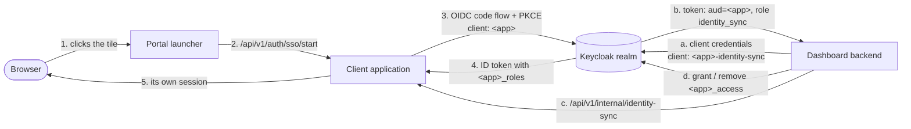

# Onboarding a client application

This guide takes an application that keeps its own user accounts (a "client"
of the portal, such as CLIMS or POES) from nothing to people opening it from the
Integrated Health Portal with their Keycloak sign-in, linked and managed by the
dashboard's identity sync. It covers what the application team builds, what
the Keycloak, portal and dashboard administrators configure, how to go live,
and how to troubleshoot each stage.

CLIMS is the reference implementation throughout. Its code is in the CLIMS
repository (`backend/internal/features/auth/sso.go` for sign-in,
`identity_sync.go` for the dashboard API), with its own guide in
`docs/sso-and-identity-sync.md` and runbook in `infra/sso/README.md`. POES
(Poesgo) is the second implementation, and differs where noted.

Related pages:

| Page | Use it for |
| --- | --- |
| [Connected applications](connected-applications.md) | CLIMS and POES values side by side, registration commands |
| [Identity-sync contract (v1.1)](identity-sync-contract.md) | Exact request and response formats of the API the application implements |
| [Adapter and conformance suite](identity-sync-adapter.md) | The Go adapter, and the conformance suite for any language |
| [Application and system onboarding handbook](../platform-onboarding.md) | The portal registry, lifecycle and access roles in detail |
| [Application manifests](../application-manifests.md) | The manifest file an application ships for its portal entry |
| [Identity-sync pilot runbook](../operations/identity-sync-pilot.md) | The first production links, step by step |
| [Testing connected applications locally](local-integration-testing.md) | Running the whole flow on one machine |

## 1. The model



There are two connections, and both are needed:

- **Sign-in (1–5).** The browser goes from the portal to the application, which
  runs its own OIDC code flow against the realm. Keycloak reuses the existing
  sign-in, so there is no second login. The application then starts its own
  session.
- **Identity sync (a–d).** The dashboard calls the application server to server:
  it lists accounts, links each one to a Keycloak user, and ends the
  application's sessions when it removes someone's access.

The rules that keep this safe:

1. **Keycloak proves who the person is; the application decides what they can
   do**, using its own roles and data scopes on the linked account. A Keycloak
   role never grants data access by itself.
2. **The access role is the gate.** `<app>_access` on the application's
   Keycloak client shows the portal tile and lets sign-in through. Removing it
   stops new sign-ins.
3. **Accounts are linked, never matched at sign-in.** The application finds the
   account only by the link `(issuer, Keycloak subject)` that the dashboard
   recorded. Email is never a fallback, so a person with the access role but no
   link is refused.
4. **Links are bound to the issuer.** A new Keycloak issuer (another realm or
   hostname, or HTTP to HTTPS) means new links.
5. **Removal ends sessions.** The dashboard removes the access role, then calls
   `POST /sessions/revoke`. The application ends that person's sessions at
   once and refuses tokens issued before the revocation.
6. **Nothing secret crosses between systems.** The application checks the
   dashboard's tokens against Keycloak's public keys; each side keeps only its
   own client secret.

## 2. Agree the identifiers

Agree these before anyone builds or configures anything. Each one appears in
several places, and a mismatch is the most common onboarding fault.

| Item | Pattern | CLIMS | POES |
| --- | --- | --- | --- |
| Registry ID = interactive client ID | `<app>` | `clims` | `poesgo` |
| Access role (client role on `<app>`) | `<app>_access` | `clims_access` | `poesgo_access` |
| ID-token roles claim | `<app>_roles` | `clims_roles` | `poesgo_roles` |
| Sync client (service account only) | `<app>-identity-sync` | `clims-identity-sync` | `poesgo-identity-sync` |
| Sync role (client role on `<app>`) | `identity_sync` | `identity_sync` | `identity_sync` |
| Sync token audience | `<app>` | `clims` | `poesgo` |
| Account ID format | `uuid`, `positive-integer` or `opaque` | `uuid` | `positive-integer` |
| Public origin | HTTPS | `https://clims.health.go.ug` | `https://poes.health.go.ug` |
| Portal launch URL | `<origin>/api/v1/auth/sso/start` | as pattern | as pattern |
| Sign-in callback | `<origin>/api/v1/auth/sso/callback` | as pattern | as pattern |
| Sync base URL | `<origin>/api/v1/internal/identity-sync` | as pattern | as pattern |

## 3. What the application team builds

### 3.1 Sign-in endpoints

| Route | Does |
| --- | --- |
| `GET /api/v1/auth/sso/start` | Creates `state`, `nonce` and a PKCE verifier, keeps them in a short-lived (5 minutes) HttpOnly, SameSite=Lax cookie scoped to the SSO path, and redirects to Keycloak's authorization endpoint with `code_challenge_method=S256` |
| `GET /api/v1/auth/sso/callback` | Clears the flow cookie, checks `state`, redeems the code with the verifier and the client secret, verifies the ID token, checks the account, and starts a session |

Use the realm's discovery document and a maintained OIDC library. On the
callback, refuse unless all of these hold, in this order:

1. `state` matches the flow cookie, and Keycloak returned a code rather than an error;
2. the ID token verifies (signature, issuer exactly equal to the configured
   issuer, audience includes `<app>`, not expired) and its `nonce` matches;
3. `azp`, when present, is `<app>`; with several audiences it must be present and be `<app>`;
4. the `<app>_roles` claim contains `<app>_access`;
5. an account is linked to `(issuer, sub)`;
6. that account is eligible to sign in (CLIMS: active with a role; POES:
   active, not locked, with a role);
7. the token was issued after the account's last revocation (the
   `sessions_revoked_at` marker in CLIMS). Re-check this, and the link, inside the
   transaction that creates the session, so a sign-in that overlaps a revocation
   cannot leave a live session.

Report a refusal with a short, stable reason the person can act on. CLIMS
redirects to its sign-in page with `?sso_error=`:

| Reason | Meaning |
| --- | --- |
| `invalid` | Bad or missing state, nonce or ID token; a stale tab or a sign-in not started from the portal |
| `denied` | No `<app>_access`, a token issued to another client, or access revoked after the token was issued |
| `unavailable` | No link for this identity, or the linked account is disabled or has no role |
| `failed` | Keycloak or the database unreachable, or a wrong client secret |
| `expired` | The session handoff was older than 60 seconds or already used |

POES answers with JSON errors instead: `invalid_sso_response` (400),
`invalid_sso_identity` (401), `sso_access_denied` (403),
`sso_account_unavailable` (403) and `sso_exchange_failed` (502).

### 3.2 Handing the session to the web front end

The callback runs on the API. Choose how the front end receives the session:

- **Same origin (CLIMS).** The callback creates a normal session, puts its
  refresh token in a 60-second, single-use HttpOnly cookie scoped to
  `/api/v1/auth/sso/exchange`, and redirects to the front end's `/sso/complete`.
  That page calls `POST /api/v1/auth/sso/exchange`, which reads and clears the
  cookie and returns the session like a password login does. Password sign-in
  can stay alongside, as it does in CLIMS.
- **Separate front-end origin (POES).** With `OIDC_WEB_HANDOFF_URL` set, the
  callback stores the session under a random single-use code (60 seconds, kept
  only as a hash) and redirects to the front end's `/auth/sso?code=…`. The front
  end's server exchanges the code at `POST /api/v1/auth/sso/exchange` and keeps
  the token in its own httpOnly cookie. Codes live in the process that ran the
  callback, so route the SSO paths to one replica or use sticky sessions.
- **Backend page only.** Without a front end, the callback can set its own
  session cookie and show a minimal signed-in page, as POES does when
  `OIDC_WEB_HANDOFF_URL` is unset.

Never put tokens in URLs, and never accept a portal or Keycloak token as the
application's own session.

### 3.3 The identity-sync API (contract 1.1)

Implement these under `/api/v1/internal/identity-sync`. Formats, limits and
error bodies are in the [contract](identity-sync-contract.md).

| Route | Does |
| --- | --- |
| `GET /` | Descriptor: `contract`, `version` `1.1`, `application`, `accountIdFormat`, `maxPageSize`, `capabilities` (`accounts.list`, `identity.link`, `sessions.revoke`) |
| `GET /accounts` | Pages through accounts eligible for linking, with each account's email and current link |
| `PUT /accounts/{id}/identity` | Records the link `(issuer, subject)`. Idempotent for the same link; 409 if the account or the identity is already linked differently. Links are never replaced through the API |
| `POST /sessions/revoke` | Ends every session of the account linked to `(issuer, subject)`, and records the time so older tokens are refused |

Authorize every call: the Bearer token must verify against the realm, carry
`aud=<app>` and `azp=<app>-identity-sync`, and hold the `identity_sync` role.
Refuse everything else (401 for a bad token, 403 for the wrong client or a
missing role). Expose the routes only when `IDENTITY_SYNC_CLIENT_ID` is set, and
keep them off the internet if the proxy allows it.

Go applications can use the published adapter, which implements the HTTP side
over a small store interface. Any language can be checked with the conformance
suite (see [the adapter page](identity-sync-adapter.md)). The suite's test-only
session probe (`IDENTITY_SYNC_TEST_PROBE=1`) must refuse to start in production.

### 3.4 Data

| Table | Purpose |
| --- | --- |
| `user_oidc_identities (user_id, issuer, subject)` | The links. Unique on `(issuer, subject)` and on `(user_id, issuer)` |
| A revocation marker per account (CLIMS: `users.sessions_revoked_at`) | Tokens issued at or before it are refused |

### 3.5 Configuration and startup

| Setting | Notes |
| --- | --- |
| `OIDC_ISSUER` | Exactly the `issuer` from the realm's discovery document. Discovered at startup |
| `OIDC_CLIENT_ID` | `<app>`. Setting it turns portal sign-in on |
| `OIDC_CLIENT_SECRET` | The `<app>` client's secret. Only the application holds it |
| `OIDC_PUBLIC_ORIGIN` | The application's browser origin: scheme and host only, no path or trailing slash |
| `IDENTITY_SYNC_CLIENT_ID` | `<app>-identity-sync`. Turns the sync routes on |

Fail closed at startup: exit when any of these is missing while
`OIDC_CLIENT_ID` is set, when the issuer cannot be discovered, or when a URL uses
HTTP outside loopback or in production. CLIMS also enables the sync routes only
with an HTTPS issuer.

### 3.6 What to ship

Put these in the application repository, as CLIMS does in `infra/sso/`:

- a Keycloak client file for `<app>` (no secret, placeholder origin);
- a partial-import file with `<app>_access`, `identity_sync` and the sync client
  with its audience mapper (no secret);
- the portal manifest (`<app>.application.yaml`, see
  [Application manifests](../application-manifests.md));
- a runbook with the settings, refusal reasons and endpoints;
- an `.env` example with empty secrets, and git rules that ignore real secret copies.

## 4. Keycloak

A realm created from `infra/keycloak/realm-export.json` already holds the CLIMS
and POES clients. For a new application, or any other realm, check each item,
because a live realm doesn't pick up later changes to an export file:

1. **Interactive client `<app>`:** confidential, standard flow only, PKCE S256,
   exact redirect URI `<origin>/api/v1/auth/sso/callback` (no wildcards), and
   post-logout redirect URIs if the application logs out through Keycloak.
2. **Client roles on `<app>`:** `<app>_access` for people, and `identity_sync`
   for the sync service account only.
3. **Roles claim:** a client-role mapper that puts the `<app>` roles in the ID
   token as `<app>_roles`.
4. **Sync client `<app>-identity-sync`:** confidential, only *Service accounts*
   enabled, `fullScopeAllowed` off.
5. **Sync role reaches the token:** the service account holds
   `<app>` → `identity_sync`, *and* the same role is in the sync client's
   dedicated scope (Client scopes → `<app>-identity-sync-dedicated` → Scope).
   Without the scope mapping every sync call gets 403.
6. **Audience:** an audience mapper on the sync client adding `<app>` to `aud`.
7. **Realm user profile:** `"unmanagedAttributePolicy": "ADMIN_EDIT"`, or
   inviting users from identity sync fails (`invite_attribute_not_stored`).
8. **Realm email:** an SMTP server, or invitations fail (`invite_email_failed`).
9. **Fixed hostname:** run Keycloak with `KC_HOSTNAME`, so tokens requested
   through an internal URL still carry the public issuer.

The dashboard can create missing sync clients and complete items 4 to 6 at
startup (`serviceClients:` in `backend/config/system-rbac.seed.yaml` with
`RBAC_STARTUP_SYNC_PUSH_TO_KEYCLOAK=true`); see
[Service clients](../rbac-keycloak-sync.md#service-clients). Generate secrets
straight into their destination, never on screen.

## 5. Portal registration

1. **Import the manifest** in Admin → Systems → Import manifest (or register the
   system by hand; see the [handbook](../platform-onboarding.md)). The launch
   mode is `external` and the launch URL is the application's
   `/api/v1/auth/sso/start`.
2. **Access roles:** the system's access role is `<app>_access`.
3. **Lifecycle:** Configure → Validate → Approve → Activate, each with a reason,
   then make sure the system is enabled. Validation checks the saved registry
   values only; it does not probe the application.
4. **Avoid configuration edits on an active system.** Changing its launch URL,
   owner, support or environment fields sends it back to `configured` and
   disables it, which hides the tile for everyone (the lifecycle guard). Plan
   such edits and repeat the lifecycle afterwards.

## 6. Connect identity sync

1. **Bind the sync client** to the application as a service identity, once, as
   a portal admin with `rbac:write` and `rbac:roles:write`:

   ```text
   PUT /api/v1/admin/platform/applications/<app>/identities/<app>-identity-sync
   {"subject": "<Keycloak user ID of service-account-<app>-identity-sync>",
    "scopes": [], "enabled": true, "reason": "CHG-<ticket>: <app> identity sync"}
   ```

2. **Register** the application, from the backend CLI or Admin → RBAC → This
   application → Identity sync:

   ```sh
   moh-sso identity-sync register --app <app> --origin <origin> \
     --sync-client <app>-identity-sync --access-role <app>_access \
     --credential keycloak:<app>-identity-sync --account-id-format <format> \
     --reason "CHG-<ticket>: <app> identity sync" --enable
   moh-sso identity-sync describe --app <app>
   ```

   With `keycloak:<sync client>` the dashboard reads the secret from Keycloak
   when it needs it, so nothing is mounted. If the origin resolves to a private
   address from the dashboard, add that host to
   `IDENTITY_SYNC_ALLOWED_PRIVATE_HOSTS`.

3. **Expect** `describe` to show the live descriptor: version `1.1`, the
   application ID, its account ID format, and all three capabilities.

## 7. Link the people

Identity sync matches each account to a Keycloak user by verified email:

| Proposal | Situation | Next step |
| --- | --- | --- |
| `reuse` | One verified, enabled Keycloak user has the account's email | Approve and apply: links it and grants `<app>_access` |
| `create` | No Keycloak user has that email | Approve and apply: creates the user, emails an invitation, links and grants |
| `review` | No email, several matches, an unverified match, or linked under another issuer | Fix the data in the application or Keycloak, then run again |
| `linked` | Linked and holding the access role | Nothing |
| `linked_no_access` | Linked but without the access role | Grant the role in the portal if they should have access |
| `revoked` | Access was removed through the dashboard | `identity-sync restore`, then grant the role |

Ways to link:

- **One reviewed account:** `identity-sync preview`, then
  `identity-sync apply --app <app> --account <id> --approved-subject <keycloak-user-id>`.
  Apply re-runs the match and refuses if it changed.
- **A reviewed batch:** `identity-sync run start`, review and approve rows, then
  `run apply` (and `run resume` for rows that didn't finish). Follow the
  [pilot runbook](../operations/identity-sync-pilot.md) for the first production links.
- **Automatically at backend start:** `IDENTITY_SYNC_AUTO_LINK_APPS=<app>`
  approves `reuse` and `create` rows without review (see
  [Connected applications](connected-applications.md#automatic-linking-at-startup)).
  Use it only when the application's emails are trusted: they decide who is
  linked to whom and who receives an invitation.

A portal user who should use the application but has no account in it needs one
created in the application, with the same email, before it can be linked.

**Removing access.** Removing `<app>_access` through the portal or the users API,
or `identity-sync revoke`, removes the role and calls `POST /sessions/revoke`.
Granting the role again through the portal clears the revocation;
`identity-sync restore` clears it without granting.

## 8. Go-live checklist

Application:

- [ ] Starts with the production settings, and refuses to start with any missing or with HTTP URLs
- [ ] Conformance suite passes in a test environment (probe on there, off in production)
- [ ] Sync routes reachable from the dashboard's network, not from the internet

Keycloak and portal:

- [ ] Section 4's nine items checked in the live realm
- [ ] System active and enabled, with access role `<app>_access`; launch URL is production's
- [ ] Sync client bound; `register --enable` done; `describe` shows 1.1 and three capabilities

Pilot user (in order):

- [ ] Has `<app>_access`; the tile shows in the portal's application menu
- [ ] Linked; the tile opens the application without a second login, as the right account
- [ ] A protected page and one harmless permitted action work
- [ ] A user without the access role, and a user without a link, are refused with the expected reason
- [ ] `revoke` ends the pilot's open session at once; a new sign-in is refused; restore and re-grant bring them back
- [ ] Logout: the application ends its own session. Portal logout ends the Keycloak session, so the next launch asks for a login

## 9. Troubleshooting

Work through the stages in order: a fault in an earlier stage usually shows up as
a confusing symptom in a later one.

### 9.1 The application doesn't start

| Symptom | Cause and fix |
| --- | --- |
| Exits with "configure OIDC_ISSUER, OIDC_CLIENT_ID, OIDC_CLIENT_SECRET and OIDC_PUBLIC_ORIGIN" | One is empty, `OIDC_PUBLIC_ORIGIN` has a path or trailing slash, or a URL uses HTTP outside loopback or in production |
| Exits with an OIDC discovery error | The issuer is unreachable from the application, or isn't exactly the discovery document's `issuer`. Inside a container, `localhost` is the container itself |
| Exits with "identity sync requires an HTTPS issuer and a dedicated service client" (CLIMS) | `IDENTITY_SYNC_CLIENT_ID` set with an HTTP issuer, or equal to the interactive client ID |
| Refuses to start with `IDENTITY_SYNC_TEST_PROBE` | The probe is on in production (or `APP_ENV` unset), or without `IDENTITY_SYNC_CLIENT_ID` |

### 9.2 The tile doesn't show, or opens the wrong place

| Symptom | Cause and fix |
| --- | --- |
| No tile for a user | They lack `<app>_access` (check Effective Access in Admin → RBAC), or the system isn't active and enabled |
| The tile disappeared for everyone | An active system's configuration was edited, which sent it back to `configured` and disabled it. Repeat Validate → Approve → Activate |
| The tile opens the wrong host or port | The launch URL is another environment's. Edit it, then repeat the lifecycle |
| The portal itself keeps returning to its public "Sign in" page | The portal user lacks the realm role that carries portal access (`user`); `/api/v1/auth/me` is 200 while `/api/v1/me/health-contexts` is 403 |

### 9.3 Sign-in is refused

| Symptom | Cause and fix |
| --- | --- |
| Keycloak shows "Invalid redirect uri" | The `<app>` client's redirect URI doesn't exactly match `<OIDC_PUBLIC_ORIGIN>/api/v1/auth/sso/callback` |
| Keycloak asks for a password again | The person isn't signed in to the portal in this browser, or the application uses another realm or Keycloak hostname |
| `denied` / `sso_access_denied` | No `<app>_access` in the ID token's `<app>_roles` (check the roles mapper), a token for another client, or access revoked |
| `unavailable` / `sso_account_unavailable` | No link for this identity under this issuer, or the account is disabled, locked or has no role. Link with `apply`; after an issuer change, link again |
| `invalid` / `invalid_sso_response` | A stale tab, a sign-in not started at `/sso/start`, or a blocked flow cookie |
| `failed` / `sso_exchange_failed` | Wrong `OIDC_CLIENT_SECRET`, or Keycloak or the database unreachable from the application |
| `expired` | The handoff took longer than 60 seconds or was used twice; start again from the portal |
| POES admin shows "Portal sign-in did not complete" | The handoff code was reused, expired, or reached another backend replica |

To see what the application received, decode the ID token's claims in a test
environment and compare `iss`, `aud`, `azp` and `<app>_roles` with section 2.

### 9.4 Identity sync

| Symptom | Cause and fix |
| --- | --- |
| `register` refuses the origin as private | Add its host to `IDENTITY_SYNC_ALLOWED_PRIVATE_HOSTS` |
| `register` reports a binding error | The sync client isn't bound as an enabled service identity of `<app>` (section 6, step 1) |
| The dashboard can't get a token | The token endpoint isn't HTTPS, or the sync client's secret is wrong or unreadable through the admin client |
| 404 for every sync path | `IDENTITY_SYNC_CLIENT_ID` isn't set, so the routes are off |
| 401 from the application | Token expired, from another issuer, or `aud` lacks `<app>` (audience mapper) |
| 403 from the application | Token not from `<app>-identity-sync`, or `identity_sync` is missing from its service account or its dedicated scope |
| 409 on `PUT …/identity` | The account or the identity is already linked differently; links aren't replaced through the API |
| Preview shows mostly `review` | Accounts without emails, duplicate emails, or unverified Keycloak emails. Fix the data at the source |
| Preview shows `create` for people who have portal accounts | The emails differ between the application and Keycloak |

Run rows record a stable code in `last_error`:

| Code | Cause and fix |
| --- | --- |
| `invite_attribute_not_stored` | The realm user profile lacks `unmanagedAttributePolicy: ADMIN_EDIT`. Set it, then `run resume` |
| `invite_email_failed` | The user was created but the invitation email failed: check the realm's SMTP settings, then resume |
| `invite_email_collision` | An unrelated Keycloak user already has that email; decide whether it is the same person, then link with `apply` or change one email |
| `invite_ambiguous` | More than one Keycloak user is marked as created for this account; remove the duplicate in Keycloak |
| `invite_user_disabled` | The Keycloak user created for this account was disabled since; enable it or reject the row |
| `invite_origin_mismatch` | The Keycloak user created for this account now has a different email; fix the email on one side |
| `invite_failed` | Any other invitation failure, including an account with no usable ID or email (for example an email that isn't a valid address) |
| `account_changed` / `directory_changed` | The account or the Keycloak match changed since review; the row goes back to review |
| `link_conflict` | The application already has a different link for the account |
| `account_ineligible` / `account_missing` | The application no longer lists the account as eligible |
| `grant_failed` | The link was made but granting `<app>_access` failed; `run resume` retries the grant |
| `identity_revoked` | The subject's access was revoked; restore it first |

### 9.5 Sessions and logout

| Symptom | Cause and fix |
| --- | --- |
| A revoked person still uses an open session | The application doesn't check its revocation marker on every request, or `sessions.revoke` failed (`sessions_app_rejected`, `sessions_app_unavailable`): check `identity-sync revocations` and resume |
| Portal logout leaves the application signed in | Expected: portal logout can't end independently managed sessions. Sign out of the application, or rely on its session lifetime |
| Portal logout ends on Keycloak's "Invalid redirect uri" | The `dashboard-web` client lacks the portal's post-logout redirect URI |

## 10. Operations

| Task | How | Effect |
| --- | --- | --- |
| Rotate the `<app>` client secret | Keycloak → Clients → `<app>` → Credentials → Regenerate; update the application; restart it | Portal sign-ins fail between the two steps |
| Rotate the sync secret | Regenerate in Keycloak | With `keycloak:` references the next sync call reads it; with `env:` replace the mounted file and restart the backend |
| Suspend the application | Lifecycle → Suspend | The tile and new sign-ins stop; existing application sessions end only through revocation or expiry |
| Take one person's access away | Remove `<app>_access` in the portal, or `identity-sync revoke` | Role removed and sessions ended at once |
| Move to a new Keycloak issuer | Change `OIDC_ISSUER`, then link everyone again | Existing links stop matching until relinked |

Do not use direct database edits, broad admin roles, or disabled token checks as
onboarding shortcuts. Each one hides the fault that the checks above would show.
