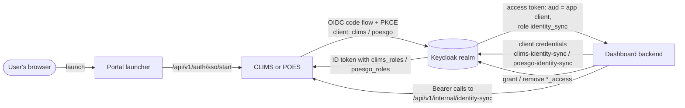

# Connected applications: CLIMS and POES

CLIMS and POES (Poesgo) keep their own user accounts. The dashboard connects
them to MoH Keycloak in two ways: users launch them from the portal and sign in
with their Keycloak session, and the dashboard's identity sync links each local
account to its Keycloak user and ends local sessions when portal access is
removed.

This page is the dashboard-side onboarding for both applications. It collects
their values in one place, says who holds which credential, and gives the
registration steps. Each application's repository has the matching guide for
its own side:

| Application | Repository guide | Runbook |
| --- | --- | --- |
| CLIMS | `docs/sso-and-identity-sync.md` in the CLIMS repository | `infra/sso/README.md` there |
| POES | `docs/23-sso-and-identity-sync-onboarding.md` in the poesGo repository | `infra/sso/README.md` there |

Related dashboard documents:

- [Identity-sync contract (v1.1)](identity-sync-contract.md): what each application implements.
- [Adapter and conformance suite](identity-sync-adapter.md): for teams adding a new application.
- [Dashboard design](../architecture/identity-sync.md): registry, batches, removal.
- [Production pilot runbook](../operations/identity-sync-pilot.md): the procedure for the first production links.
- [Application identity contract](../platform-identity.md#identity-reconciliation-clims-poes): CLI settings.

## 1. How it fits together



Granting portal access to an application means two things: the user holds the
application's access role in Keycloak, and their Keycloak identity is linked
to their local account. Removing access reverses both: the dashboard removes
the access role, so new sign-ins are refused, then calls
`POST /sessions/revoke` on the application, which ends existing sessions.

## 2. Values for each application

| | CLIMS | POES |
| --- | --- | --- |
| Registry app ID (`--app`) | `clims` | `poesgo` |
| Interactive client | `clims` | `poesgo` |
| Access role | `clims_access` | `poesgo_access` |
| ID-token roles claim | `clims_roles` | `poesgo_roles` |
| Sync client | `clims-identity-sync` | `poesgo-identity-sync` |
| Sync token audience | `clims` | `poesgo` |
| Account ID format | `uuid` | `positive-integer` |
| Contract | 1.1 | 1.1 |
| Production origin (realm export) | `https://clims.health.go.ug` | `https://poes.health.go.ug` |
| Registry credential | `keycloak:clims-identity-sync` (or `env:CLIMS_SYNC_CLIENT_SECRET`) | `keycloak:poesgo-identity-sync` (or `env:POESGO_SYNC_CLIENT_SECRET`) |
| Mounted secret file variable (`env:` only) | `CLIMS_SYNC_CLIENT_SECRET_FILE` | `POESGO_SYNC_CLIENT_SECRET_FILE` |
| App setting that enables sync | `IDENTITY_SYNC_CLIENT_ID=clims-identity-sync` | `IDENTITY_SYNC_CLIENT_ID=poesgo-identity-sync` |
| Password sign-in alongside portal sign-in | Yes. Web and mobile keep it | No. In `AUTH_PROVIDER=oidc` POES accepts only its SSO session, so its web admin and mobile apps can't sign in to that deployment yet |

With `keycloak:<sync client>` the dashboard reads the sync client's secret
from Keycloak whenever it needs it, through its admin client, so nothing is
copied or mounted. With `env:`, the backend entrypoint loads any mounted
`<NAME>_SYNC_CLIENT_SECRET_FILE` as `<NAME>_SYNC_CLIENT_SECRET`, which is what
the reference reads. The deprecated `clims-identity-sync` and `poes-identity-sync` CLI
commands use the older `CLIMS_SYNC_*` and `POES_SYNC_*` settings described in
[platform identity](../platform-identity.md#identity-reconciliation-clims-poes).
Prefer the registry commands below.

## 3. Credentials: who holds what

| Credential | Held by | Notes |
| --- | --- | --- |
| `clims` / `poesgo` client secret | The application only | The dashboard never needs it |
| Application `JWT_SECRET` | The application only | Signs the application's own sessions |
| `clims-identity-sync` / `poesgo-identity-sync` secret | Keycloak, read by the dashboard only | With `keycloak:` it stays in Keycloak; with `env:` it is mounted as a file. Never pasted on a command line |
| Keycloak admin client (`KEYCLOAK_ADMIN_CLIENT_ID` / `_SECRET`) | The dashboard only | Looks up users and grants or removes `<app>_access` |

The application verifies sync tokens against Keycloak's public keys, so the
dashboard and the application never share a secret. Rotate a sync secret in
Keycloak (Clients → the sync client → Credentials → Regenerate). With a
`keycloak:` reference that is all: the next sync call reads the new secret.
With `env:`, also replace the dashboard's mounted file and restart the
backend; sync calls fail in between. Users are not affected either way.

## 4. Keycloak

`infra/keycloak/realm-export.json` and `realm-export-prod.json` define all four
clients: both access roles, both `identity_sync` roles, the audience mappers,
the scope mappings and the service-account role assignments. A live realm does
not pick changes up from the file, so check each item in the admin console:

1. `clims` and `poesgo` exist with the redirect URI
   `<origin>/api/v1/auth/sso/callback`, PKCE S256, and a client-role mapper that
   puts their roles in the ID token as `clims_roles` / `poesgo_roles`.
2. `clims-identity-sync` and `poesgo-identity-sync` are confidential, have only
   *Service accounts* enabled, and have `fullScopeAllowed` off.
3. Each sync client's service account holds its application's `identity_sync`
   role, and the same role is in the sync client's dedicated scope (Client
   scopes → `<sync client>-dedicated` → Scope). Without the scope mapping the
   role never reaches the token and every call gets 403.
4. Each sync client has an audience mapper adding the application client ID to
   `aud`.
5. Realm settings → User profile has `"unmanagedAttributePolicy": "ADMIN_EDIT"`;
   invitations fail without it.
6. Keycloak runs with a fixed public hostname (`KC_HOSTNAME`), so tokens
   requested through an internal URL still carry the public issuer.

A realm that wasn't created from the export has two ways to get the sync
clients:

- **Let the dashboard create them.** Both sync clients are listed under
  `serviceClients:` in `backend/config/system-rbac.seed.yaml`. With
  `RBAC_STARTUP_SYNC_PUSH_TO_KEYCLOAK=true`, backend startup creates any that
  are missing and completes items 2 to 4 above (service account, role, scope
  mapping, audience mapper). It never touches a client of another shape and
  never sets a secret; Keycloak generates it. See
  [Service clients](../rbac-keycloak-sync.md#service-clients).
- **Import them.** Each application repository's `infra/sso/` folder has
  import files that are copies of the export's definitions, and the
  application guides list the manual steps that partial import can't carry.

Sync clients registered with `keycloak:<sync client>` need no further secret
step. Any other secret that is created or regenerated (an application's own
client secret, or a sync secret registered with `env:`) goes straight into its
destination without being displayed.

## 5. Connect an application

Do these in order for each application. The examples use POES. For CLIMS,
substitute the values from section 2.

1. **Application side.** The application team sets its OIDC settings and
   `IDENTITY_SYNC_CLIENT_ID`, applies its migrations, and confirms
   `/api/v1/internal/identity-sync` is reachable from the dashboard's network.
   Their repository guide has the details.
2. **Secret.** Nothing to do when you register `keycloak:poesgo-identity-sync`
   in step 4. To use `env:` instead, mount the sync client's secret and set
   `POESGO_SYNC_CLIENT_SECRET_FILE` to its path. If the application's origin
   resolves to a private address from the dashboard (split-horizon DNS), add
   that host name only to `IDENTITY_SYNC_ALLOWED_PRIVATE_HOSTS`.
3. **Service identity binding.** The registry accepts only a sync client that
   is an enabled service identity of the application. A portal admin with
   `rbac:write` and `rbac:roles:write` registers it once:

   ```text
   PUT /api/v1/admin/platform/applications/poesgo/identities/poesgo-identity-sync
   {"subject": "<Keycloak user ID of service-account-poesgo-identity-sync>",
    "scopes": [], "enabled": true, "reason": "CHG-<ticket>: POES identity sync"}
   ```

4. **Register and describe.** Run through the backend entrypoint so mounted
   secrets load (see the pilot runbook's
   [Running the CLI](../operations/identity-sync-pilot.md#running-the-cli)):

   ```sh
   moh-sso identity-sync register --app poesgo \
     --origin https://poes.health.go.ug \
     --sync-client poesgo-identity-sync \
     --access-role poesgo_access \
     --credential keycloak:poesgo-identity-sync \
     --reason "CHG-<ticket>: POES identity sync" \
     --enable

   moh-sso identity-sync describe --app poesgo
   ```

   **Expect:** the live descriptor shows `version` `1.1`, `application`
   `poesgo`, `accountIdFormat` `positive-integer`, `maxPageSize` 100 and the
   capabilities `accounts.list`, `identity.link` and `sessions.revoke`. CLIMS
   shows `clims` and `uuid`.

   The same registration is available in the portal: Admin → RBAC → **This
   application** → select the application → **Identity sync** tab.

5. **Portal launcher entry.** To launch the application from the portal,
   import its application manifest on Admin → Systems → **Import manifest**
   (CLIMS ships `infra/sso/clims.application.yaml`; POES has none yet) and
   take it through the lifecycle review. See
   [Application manifests](../application-manifests.md).

6. **Preview, review, apply, rehearse removal.** Follow the
   [pilot runbook](../operations/identity-sync-pilot.md) from step 2. It is
   written for CLIMS; for POES use the substitutions in its
   [Running the pilot for POES](../operations/identity-sync-pilot.md#running-the-pilot-for-poes)
   section.

Rehearse the whole sequence first in the disposable stack, which runs CLIMS,
POES, Keycloak and the dashboard together: `make -C infra identity-sync-e2e-test`
(see `infra/compose/identity-sync-e2e/README.md` and `e2e/identity-sync/README.md`).

To test a local CLIMS and POES against the dev stack instead, with the portal
launcher, identity sync and logout, follow
[Testing connected applications locally](local-integration-testing.md). It uses
the overrides in `infra/compose/local-https/`, which move the dev Keycloak issuer
to HTTPS, as CLIMS needs to enable sync.

### Automatic linking at startup

Set `IDENTITY_SYNC_AUTO_LINK_APPS` (comma-separated registry application IDs,
for example `clims`) to link accounts in the background every time the backend
starts, without a reviewer. Each pass:

1. resumes earlier auto-link runs that did not finish (for example a failed
   invitation email);
2. starts a run, approves its `reuse` and `create` rows as `system:auto-link`
   with a note saying so, and applies it: `reuse` links the one verified
   Keycloak user with the account's email; `create` makes a Keycloak user,
   emails an invitation (verify email and set a password) and links it. Both
   grant the access role;
3. leaves `review` (no email, ambiguous, unverified, linked under another
   issuer), `linked_no_access` and `revoked` rows alone. They still need a person.

The pass runs on one replica (Postgres advisory lock) and retries every 30 seconds,
up to 20 times, while the application is unreachable. Every link, invitation and
grant goes through the same checks as a reviewed run, and the run is visible in
`identity-sync run show` and the portal with `system:auto-link` as creator and reviewer.

This skips the review that the [pilot runbook](../operations/identity-sync-pilot.md)
relies on: an account's email in the application decides which Keycloak user
it is linked to, and who receives an invitation. Enable it only when the
application's emails are trusted, and keep it empty for the pilot.

## 6. Adding another application

1. The application implements the [contract](identity-sync-contract.md). A Go
   application can use the adapter in `backend/core/identitysync`; any language
   can be checked with the conformance suite
   ([adapter guide](identity-sync-adapter.md)).
2. Add its interactive client, sync client, roles, audience mapper, scope
   mapping and service-account role to the realm exports, following the CLIMS
   and POES entries.
3. Add a column to the table in section 2, then connect it as in section 5.

## 7. Troubleshooting

| Symptom | Likely cause |
| --- | --- |
| `register --enable` reports a private-origin error | The origin resolves to an internal address; see `IDENTITY_SYNC_ALLOWED_PRIVATE_HOSTS` |
| `register` reports a binding error | Step 3's service identity is missing or disabled |
| `describe` or a run gets 404 from the application | The application hasn't set `IDENTITY_SYNC_CLIENT_ID`, so its sync routes are off |
| 401 from the application | Token from another realm or issuer, expired, or `aud` lacks the application client ID (audience mapper) |
| 403 from the application | Token not from the registered sync client, or `identity_sync` is missing from its service account or its dedicated scope |
| Links apply but users can't sign in | The link's issuer differs from the application's `OIDC_ISSUER` (check `KEYCLOAK_EXTERNAL_URL` and `KC_HOSTNAME`), or the user lacks the access role |
| POES users can sign in from the portal but the POES web admin or mobile app stops working | That POES deployment switched to `AUTH_PROVIDER=oidc`; those clients need `local` mode for now |
| 503 from the application | Its database is unavailable; runs retry after `Retry-After` |
