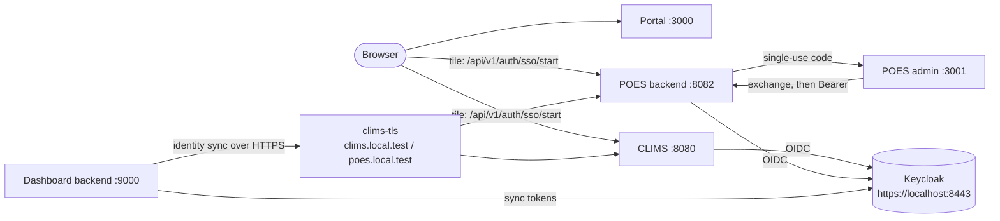

# Testing connected applications locally

This guide is for testing CLIMS and POES (Poesgo) against the dashboard dev
stack on one machine: launching from the portal, single sign-on, identity sync,
access removal and logout. It explains how the pieces fit, the test checklist,
and the problems you are likely to hit.

The commands live in [infra/compose/local-https](../../infra/compose/local-https/README.md).
For automated suites on a throwaway stack with synthetic data, use the
[identity-sync e2e stack](../../infra/compose/identity-sync-e2e/README.md)
instead. Production onboarding is in [Connected applications](connected-applications.md).

## 1. How it fits together



- **HTTPS issuer.** CLIMS enables identity sync only with an HTTPS issuer, and
  the dashboard mints sync tokens only at an HTTPS token endpoint. The
  `local-https` overrides therefore serve Keycloak at `https://localhost:8443`
  with a local CA, and pin it as the issuer (`KC_HOSTNAME`), so tokens carry the
  same issuer whichever address they were requested at.
- **Reaching `localhost:8443` from containers.** CLIMS and POES require a
  loopback issuer when they use HTTP origins, and `localhost` inside a
  container is the container itself. Each application backend therefore shares
  the network namespace of a small Caddy proxy (`kc-loopback`) that forwards
  `https://localhost:8443` to the host's Keycloak.
- **Sync origins.** The dashboard backend calls each application's
  `/api/v1/internal/identity-sync` at `https://clims.local.test` and
  `https://poes.local.test`, served by `clims-tls` on the dev network.
  `IDENTITY_SYNC_ALLOWED_PRIVATE_HOSTS` lists both, because they resolve to
  private addresses.
- **Accounts are linked, not shared.** CLIMS and POES keep their own accounts.
  They open an account only through a link the dashboard recorded (issuer plus
  Keycloak subject); email is never a fallback. A portal user with the access
  role but no link sees "not linked" in the application.
- **POES admin handoff.** In OIDC mode POES refuses password sign-in. With
  `OIDC_WEB_HANDOFF_URL` set, a portal sign-in lands in the Next.js admin: POES
  redirects with a single-use code, the admin's server exchanges it for the SSO
  session and sends it as a Bearer token (poesGo
  `docs/23-sso-and-identity-sync-onboarding.md`, "Web handoff").

## 2. Set up

Follow the [local-https README](../../infra/compose/local-https/README.md) in
order: prepare, start the dashboard with HTTPS Keycloak, save the client
secrets, start CLIMS and POES with their overrides, register both applications
and point the launcher entries at the local addresses.

Before you start, check the live dev realm. Keycloak imports
`infra/keycloak/realm-export.json` only when the realm does not exist yet, so a
realm created earlier misses later changes to the export. In particular:

| Setting | Where | Needed for |
| --- | --- | --- |
| `unmanagedAttributePolicy: ADMIN_EDIT` | Realm settings → User profile | Inviting users from identity sync (`create` rows) |
| SMTP server (`mailhog:1025` in dev) | Realm settings → Email | Invitation emails; read them at `http://localhost:8025` |
| `dashboard-web` post-logout redirect `http://localhost:3000/` | Clients → dashboard-web → Logout settings | Portal logout returning to the portal |
| `clims` and `poesgo` redirect URIs on the local origins | Clients → clims / poesgo | Application sign-in |

## 3. Accounts and links

A person can open CLIMS or POES from the portal only when all of these hold:

1. their Keycloak user holds the application's access role (`clims_access`,
   `poesgo_access`): this is also what shows the tile in the portal;
2. the application has an active account for them, eligible to sign in (POES:
   active, not locked, with a role);
3. the dashboard has linked that account to their Keycloak user under the
   current issuer.

Identity sync matches accounts to Keycloak users by verified email. Preview shows
what it would do for each account:

| Proposal | Meaning | What links it |
| --- | --- | --- |
| `reuse` | One verified Keycloak user has the account's email | `identity-sync apply`, an approved run, or auto-link |
| `create` | No Keycloak user has that email | An approved run or auto-link: it creates the user and emails an invitation |
| `review` | No email, several matches, an unverified match, or linked under another issuer | A person: fix the data first |
| `linked` / `linked_no_access` | Already linked (with or without the access role) | Nothing; grant the role for `linked_no_access` |
| `revoked` | Access was removed | `identity-sync restore`, then grant the role |

To test as a portal user with no account in the application yet, create an
account with the same email in the application (CLIMS: Users & access; POES:
Users), then link it:

```sh
cli="docker exec -w /app moh-sso-dashboard-dev-backend-1 /tmp/moh-sso identity-sync"
$cli apply --app clims --account <clims-account-id> --approved-subject <keycloak-user-id>
```

`apply` also grants the access role. It refuses an account that is already
linked; for a linked account without access, grant the role in the portal.

### Automatic linking at startup

Set `IDENTITY_SYNC_AUTO_LINK_APPS=clims` (or `clims,poesgo`) in
`infra/env/dev.env` and restart the backend to link `reuse` and `create` rows at
every start without review (see
[Connected applications](connected-applications.md#automatic-linking-at-startup)).
On a database loaded from a dump this creates a Keycloak user, with an invitation
email, for every account that has an email but no Keycloak user. In dev the
emails go to MailHog. Accounts whose email is not a valid address fail with
`invite_failed` on every start; fix or clear their email in the application.
Follow progress in the backend log (`identity sync auto-link: …`) or with
`identity-sync run show --app clims`.

## 4. Dev data to keep in mind

- CLIMS and POES databases restored from a production dump may hold personal
  data. Link only test accounts by hand, keep auto-link off unless you mean to
  provision those users locally, and don't run `identity-sync conformance`:
  it creates links on fixture accounts.
- Changing the issuer (HTTP to HTTPS, or a new Keycloak) needs new links. Old
  links stay under the old issuer and stop matching.
- The application databases and the dev Keycloak keep these changes until you
  reset their volumes.

## 5. Test checklist

Sign in to the portal at `http://localhost:3000/` as a linked user.

**CLIMS**

1. The application menu shows CLIMS, and the tile opens it in a new tab without
   a second login.
2. A portal user without a link gets "Your portal account is not linked"
   (`sso_error=unavailable`); after `apply` they sign in.
3. `identity-sync revoke --app clims --subject <keycloak-user-id> …` removes
   `clims_access`, and an open CLIMS session gets 401 at once. A new sign-in shows
   `sso_error=denied`.
4. `identity-sync restore` and granting `clims_access` again let them back in.
5. Portal logout returns to the portal, and CLIMS's next launch asks for a login.
   An open CLIMS tab keeps its own session until it expires or the person signs
   out of CLIMS: portal logout cannot end independently managed sessions.

**POES**

1. The Poesgo tile lands in the admin (`http://localhost:3001/admin`), signed in,
   with its pages loading data.
2. Reopening the handoff URL (a used code) ends at `/login?sso=failed` with
   "Portal sign-in did not complete".
3. The admin's login page link "Sign in with the MOH Integrated Health Portal"
   signs in through the existing Keycloak session.
4. `identity-sync revoke --app poesgo …` ends the admin session on its next request.
5. The POES session has no refresh token: after the access lifetime (15 minutes
   by default) the admin returns to its login page, and the portal link signs in again.

## 6. Troubleshooting

| Symptom | Cause and fix |
| --- | --- |
| The tile is missing from the application menu | The user lacks the access role, or the system is not `active`. Editing an active system's launch URL or other configuration sends it back to `configured` and disables it (the `ihp_application_lifecycle_guard` trigger); take it through validate, approve and activate again |
| The tile opens the application on the wrong port | The seeded launch URL is production's or an old local port; set the local one (Admin → Systems) |
| The portal returns to its public "Sign in" page although `/api/v1/auth/me` is 200 | The user lacks the `user` realm role, which carries portal access; `/api/v1/me/health-contexts` returns 403 |
| CLIMS: "not linked to an active CLIMS account" (`sso_error=unavailable`) | No link for this user under the current issuer, or the account is inactive. Link it with `apply` |
| CLIMS: `sso_error=denied` | The user lacks `clims_access`, or their access was revoked |
| POES returns `sso_account_unavailable` | No link, or the POES account is inactive, locked or has no role |
| Portal logout ends on Keycloak's "Invalid redirect uri" | The live realm's `dashboard-web` client lacks the post-logout redirect `http://localhost:3000/` |
| `register --enable` fails with a private-origin error | The origin's host is missing from `IDENTITY_SYNC_ALLOWED_PRIVATE_HOSTS` |
| Dashboard backend: `bad address 'clims.local.test'` | `clims-tls` is not running on the dev network; recreate it with the dashboard override |
| CLIMS or POES exits at start with an OIDC discovery error | The backend cannot reach `https://localhost:8443`: start it with its override (it adds `kc-loopback`) |
| CLIMS gives 502 after its backend was recreated | nginx still points at the old container: `docker restart clims-nginx-1` |
| Keycloak stays unhealthy after enabling HTTPS | Its management port (9000) also switched to HTTPS; the dashboard override serves health on 8080 instead. Use the override for every `docker compose` command on Keycloak |
| Run rows fail with `invite_attribute_not_stored` | The realm's user profile lacks `unmanagedAttributePolicy: ADMIN_EDIT`. Set it, then restart the backend (auto-link) or `run resume` |
| Run rows fail with `invite_email_failed` | The realm has no working SMTP server: the user was created but not emailed. Fix SMTP, then `run resume` |
| Run rows fail with `invite_failed` | The account has no usable email, for example one that isn't a valid address |
| The POES admin fails to start: port 3000 in use | The portal uses 3000. Start POES with `POESGO_DEV_FRONTEND_PORT=3001` |
| The POES admin refuses its password login | POES is in OIDC mode, which refuses password sign-in. Use the portal link, or start POES without its override |
| The browser warns about `https://localhost:8443` | Trust the local CA (local-https README, step 1) |

## 7. Undo

Run each stack's normal `docker compose up` without the override files, and
remove the proxies (`clims-tls`, both `kc-loopback` containers): the
[local-https README](../../infra/compose/local-https/README.md#undo) has the
commands. Remove the local CA from the keychain, and delete `~/.moh-dev-https`,
if you no longer need them. Links and accounts created for testing stay in the
application databases and Keycloak until you remove them or reset their volumes.
