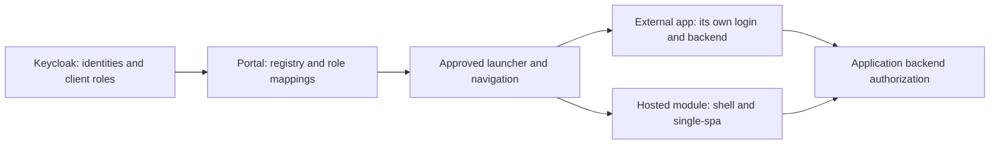
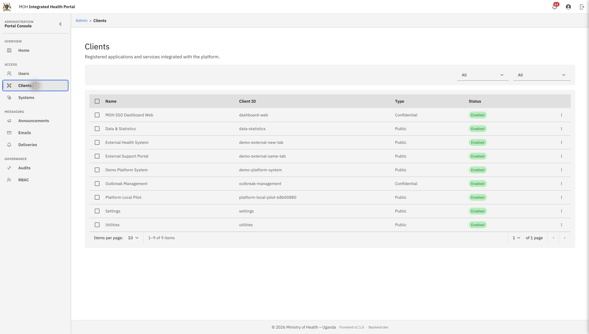
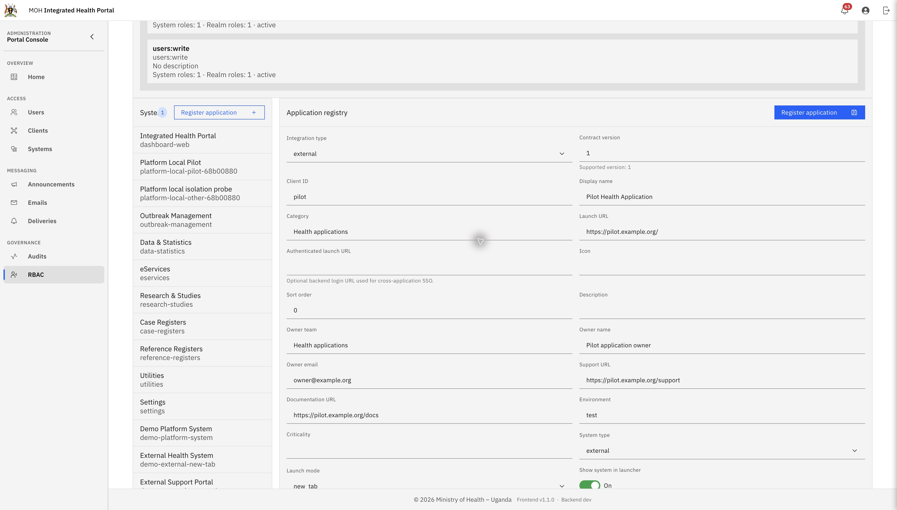
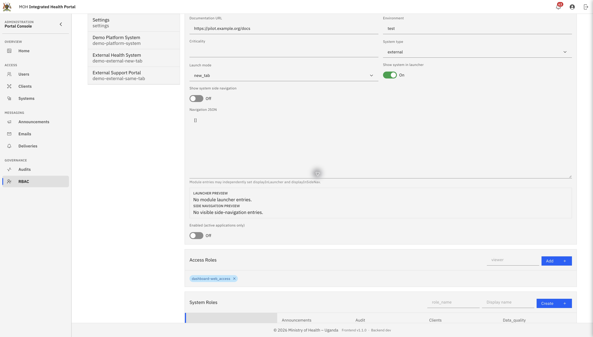
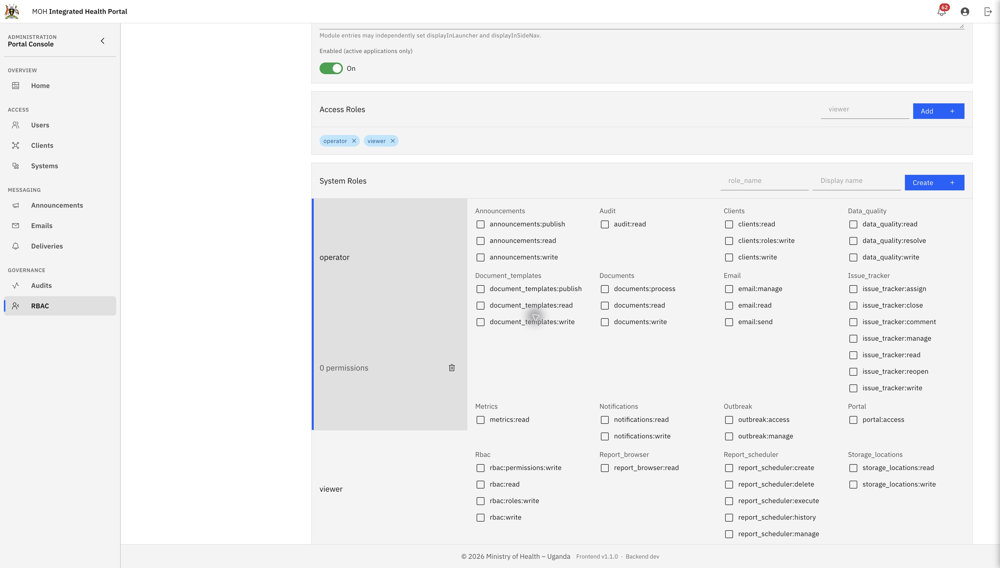
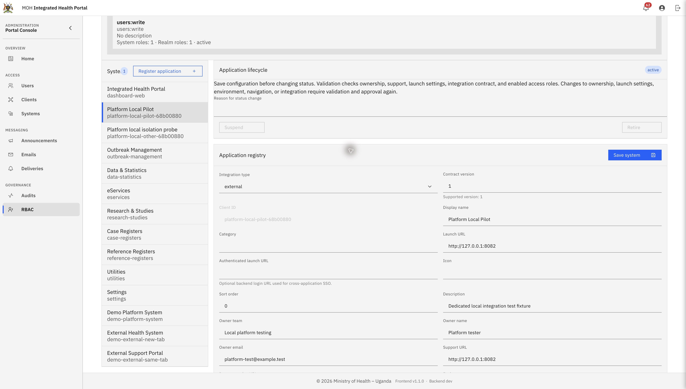
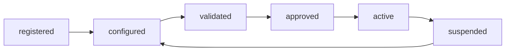
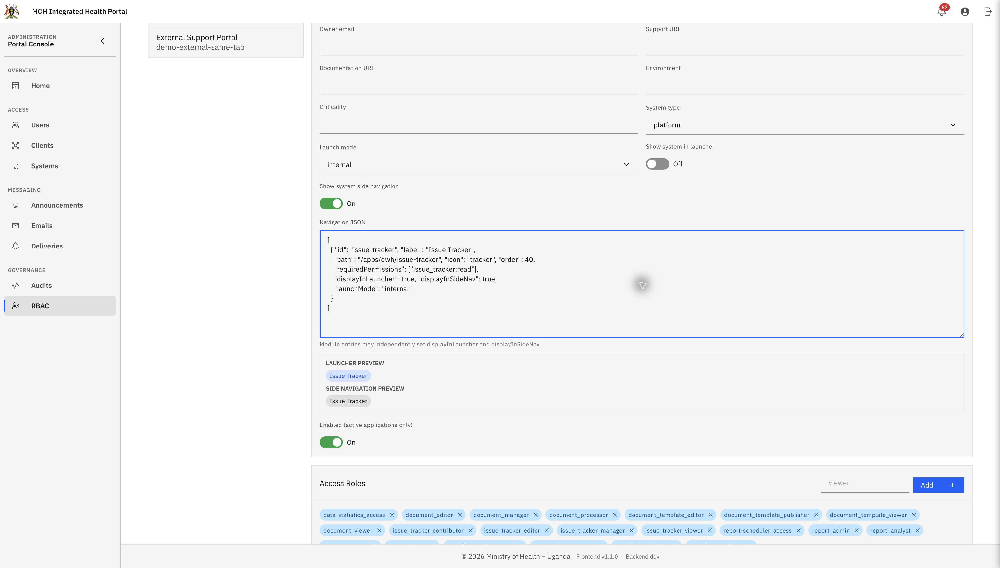

# Application and system onboarding handbook

Use this guide to add an independent application to the MOH portal, add a hosted
single-spa module, or expose another module of an existing system. It is written
for application owners, portal administrators, identity administrators, and
frontend/backend developers. Start in a test environment with a pilot user.

**Registration, sign-in, authorization, and deployment are separate steps.** A
launcher card does not install an application, create its Keycloak client, or
authorize its backend. Completing the registry lifecycle does not publish code.

## Contents

1. [Choose an integration path](#1-choose-an-integration-path)
2. [Gather prerequisites and agree identifiers](#2-gather-prerequisites-and-agree-identifiers)
3. [Configure identity in Keycloak](#3-configure-identity-in-keycloak)
4. [Register the application in the portal](#4-register-the-application-in-the-portal)
5. [Configure roles and user access](#5-configure-roles-and-user-access)
6. [Validate, approve, and activate](#6-validate-approve-and-activate)
7. [Verify an external application](#7-verify-an-external-application)
8. [Add a hosted single-spa module](#8-add-a-hosted-single-spa-module)
9. [Expose modules of an existing system](#9-expose-modules-of-an-existing-system)
10. [Connect shared services](#10-connect-shared-services)
11. [Acceptance and handover](#11-acceptance-and-handover)
12. [Troubleshooting](#12-troubleshooting)
13. [API and command reference](#13-api-and-command-reference)
14. [Screenshots and maintenance](#14-screenshots-and-maintenance)

## 1. Choose an integration path

| You are adding…                                         | Integration type                  | System type | Launch mode             | Work required                                                                         |
| ------------------------------------------------------- | --------------------------------- | ----------- | ----------------------- | ------------------------------------------------------------------------------------- |
| An independently deployed web application               | `external`                        | `external`  | `new_tab` or `same_tab` | Identity client, registry entry, access roles, application-side sign-in/authorization |
| A frontend that renders inside the portal shell         | `hosted_module`                   | `platform`  | `internal`              | Registry/role setup **and** lifecycle, route, import-map, build and asset integration |
| Another screen/module under an existing platform system | Keep the parent system's settings | `platform`  | `internal`              | Parent navigation entry and permissions; add frontend code wiring if the route is new |

An **application** is an onboarded integration. A **system** is its parent entry
in the existing registry (`ihp_systems`). In this UI these terms can refer to the
same registration. A **module** is a route/feature within a parent system. A
module can have its own launcher card without being a new system or OAuth client.

For example, `data-statistics` is a parent system; Document Management, Issue
Tracker, and Report Scheduler can be modules beneath it. The package name
`@moh-sso/issue-tracker`, parent client ID `data-statistics`, and route
`/apps/dwh/issue-tracker` serve different purposes and need not have the same text.



## 2. Gather prerequisites and agree identifiers

### People and permissions

| Task                                                        | Responsible person        | Required portal permission               |
| ----------------------------------------------------------- | ------------------------- | ---------------------------------------- |
| View registry and role mappings                             | Portal operator           | `rbac:read`                              |
| Register/edit/configure/validate/suspend                    | Registry administrator    | `rbac:write`                             |
| Create system roles or access roles; assign user access     | Role administrator        | `rbac:roles:write`                       |
| Map permissions onto roles                                  | Permission administrator  | `rbac:permissions:write`                 |
| Approve and activate                                        | Authorized approver       | Both `rbac:write` and `rbac:roles:write` |
| Bind a machine identity                                     | Integration administrator | Both `rbac:write` and `rbac:roles:write` |
| Create OAuth clients, mappers, and identity-provider grants | Keycloak administrator    | Separate Keycloak administration rights  |

The existing authenticated admin boundary still applies. A permission alone
does not bypass that boundary. Having Keycloak administration rights does not
automatically grant portal administration permissions, or the reverse.

### Environment preflight

- Use the platform branch/release that includes migrations **48–52**, rather than
  assuming the earlier `1.1.0` release contains the new platform endpoints.
- Confirm the database upgrade and restore plan. Migrations 48–51 implement the
  registry, identity bindings, shared notifications, and worker health; migration
  52 aligns Issue Tracker navigation. Run the migration checks on disposable data.
- Confirm public portal/API URLs, Keycloak issuer/realm, application URL, callback
  URL, logout URL, and support contacts. The public issuer must match tokens.
- Confirm the pilot application is already deployed and reachable if it is external.
- For shared platform APIs, configure `PLATFORM_AUTH_CLIENT_ID`,
  `PLATFORM_AUTH_CLIENT_SECRET` (or its supported secret-file mechanism), and
  `PLATFORM_AUTH_AUDIENCE` in the backend environment. See [identity setup](platform-identity.md).
- For notifications, configure SMTP and the existing notification/email workers.

The production Keycloak installation may run on bare metal. Create clients and
mappers in that installation's admin console; these onboarding steps do not
require moving it into Docker or restarting it. Local development may use the
repository's containerized Keycloak. Do not import the development realm over a
production realm to onboard one application.

### Example identifiers used throughout this guide

| Item                           | External example                     | Hosted example                            |
| ------------------------------ | ------------------------------------ | ----------------------------------------- |
| Registry/interactive client ID | `pilot`                              | Parent system `pilot-hosted`              |
| Display name                   | Pilot Health Application             | Hosted Platform Pilot                     |
| Machine client (optional)      | `pilot-service`                      | Only if its backend needs shared services |
| Package name                   | Not applicable                       | `@moh-sso/platform-pilot`                 |
| Launch URL                     | `https://pilot.example.org/`         | `/apps/pilot-hosted`                      |
| Callback URL                   | `https://pilot.example.org/callback` | Shell uses its existing portal sign-in    |
| Role names                     | `viewer`, `operator`                 | Approved parent-system role names         |

`example.org` addresses are placeholders. Use stable, unique client IDs without
spaces; keep them aligned across the registry and Keycloak. Treat renaming an
existing client ID as a migration, not a display-name edit.

Collect owner team/name/email, support URL, documentation URL, environment,
business purpose, launch behavior, intended users, and the minimum permissions
before opening the registration form. [Copy the onboarding record](templates/application-onboarding-record.md)
into your change ticket and record evidence as you go.

## 3. Configure identity in Keycloak



_Figure 1 — The portal's Clients page lists identity clients. It is separate from
the governed registry in RBAC. This is the local development inventory, not a
Keycloak client-creation wizard or proof that all registry systems have clients._

### 3.1 Independent application: interactive client

In the correct realm, open **Clients → Create client** and create an OpenID
Connect client whose **Client ID** equals the registry ID (`pilot` here).
Keycloak tab/label wording varies by installed version; the values below describe
the intended configuration. Consult the [official administration guide](https://www.keycloak.org/docs/latest/server_admin/index.html)
for your installed version's client settings.

| Setting                                         | Intended value                                                                          |
| ----------------------------------------------- | --------------------------------------------------------------------------------------- |
| Standard/authorization-code flow                | Enabled                                                                                 |
| PKCE method                                     | `S256`                                                                                  |
| Valid redirect URIs                             | Exact application callback URL(s)                                                       |
| Web origins                                     | Exact application origin(s) where browser access is required                            |
| Post-logout redirect URIs                       | Exact allowed application return URL(s)                                                 |
| Direct access/password grants and implicit flow | Disabled for this onboarding flow                                                       |
| Client authentication                           | Enabled for a backend confidential client; a public browser client cannot hold a secret |

Use your application's maintained OIDC library for discovery, state, nonce,
PKCE, token validation, and logout. A backend application keeps secrets and tokens
server-side. Configure HTTPS outside loopback development.

Create the application client roles (`viewer` and `operator`) and assign the
pilot user only the role needed for the acceptance test. These are application
roles, not portal administrator roles.

### 3.2 If the external app uses portal access decisions

For `GET /api/v1/platform/applications/pilot/access`, configure:

1. The `identity:read` capability scope, included in the token's scope string.
2. An audience mapper for the configured platform audience, normally
   `moh-platform-api`. Include the introspecting client's audience as required by
   the installed Keycloak version.
3. A nonempty user subject (`sub`) in introspection. Retain the default `basic`
   scope where provided, or configure a subject mapper for older/custom realms.
4. Resource/client roles and any required realm-role claims in introspection.

The access token must have been issued to the application's interactive client.
A portal session cookie or a token issued to `dashboard-web` is not a substitute.
See the complete [identity and authorization contract](platform-identity.md).

### 3.3 Optional machine client

Create a separate confidential client, such as `pilot-service`, only when the
application backend calls shared platform services. Enable service accounts and
disable browser/password flows. Do not grant portal/admin roles. Configure the
platform audience, capability scopes, service-account subject, and preferred
username claims. Store its secret only in the application backend's secret store.

Do not create one machine identity for every user. Do not put a machine secret in
the portal's runtime `config.js`, a hosted module, or an import map. The machine
client requires a separate registry binding; creating it in Keycloak is not enough.

### 3.4 Optional discovery attributes

Manual portal registration is supported. If using Keycloak discovery/sync, set
`portal.system=true` on the interactive/parent client and configure
`portal.accessRoles` explicitly (for example, `viewer,operator`). Set the matching
`ui.systemType`, `ui.launchMode`, `ui.launchUrl`, `ui.displayInLauncher`,
`ui.displayInSideNav`, and optional navigation attributes. Preview sync before
applying it. Do not opt a service-only client into the launcher.

New discoveries start `registered` and disabled. Discovery is not approval and
does not install an application. See [sync and drift](rbac-keycloak-sync.md).

## 4. Register the application in the portal

Open **Administration → RBAC** at `/portal/admin/rbac` on a standard `/portal`
deployment. `/admin/rbac` is the shell route; include your installation's configured
base path when entering it in the browser. Do not confuse **Clients** (Keycloak
client management) with the **Application registry** inside RBAC.

### 4.1 Start a new registration

1. In the **Systems** panel, check that the client ID is not already registered.
2. Click **Register application**. The registry form changes to creation mode.
3. Enter the agreed client ID. It is editable during creation, not on an existing system.
4. Complete the fields below, then use the **Register application** button in the
   **Application registry** panel to persist the registration.



_Figure 2 — An unsaved external application example. Match the client ID, type,
contract, launch URL, and accountable owner to your onboarding record. The example
uses reserved `example.org` addresses and was not submitted._

### 4.2 Field-by-field example

| UI field                    | External pilot                           | Hosted pilot                          | Notes                                                             |
| --------------------------- | ---------------------------------------- | ------------------------------------- | ----------------------------------------------------------------- |
| Integration type            | `external`                               | `hosted_module`                       | Must match system type                                            |
| Contract version            | `1`                                      | `1`                                   | Registry contract, not application release version                |
| Client ID                   | `pilot`                                  | `pilot-hosted`                        | Stable parent system identifier                                   |
| Display name                | Pilot Health Application                 | Hosted Platform Pilot                 | Human-readable title                                              |
| Category                    | Health applications                      | Health applications                   | Used for organization                                             |
| Launch URL                  | `https://pilot.example.org/`             | `/apps/pilot-hosted`                  | External absolute URL; hosted internal route                      |
| Authenticated launch URL    | Application backend login URL, if needed | Usually leave empty                   | Optional cross-application login entry; never a token-bearing URL |
| Icon                        | A supported icon key                     | A supported icon key                  | Use an existing system as reference                               |
| Sort order                  | An agreed number                         | An agreed number                      | Controls ordering                                                 |
| Description                 | Explain purpose                          | Explain purpose                       | Useful to users and support                                       |
| Owner team/name/email       | Real accountable contact                 | Real accountable contact              | Required before validation; plain email address                   |
| Support URL                 | Reachable support page                   | Reachable support page                | Required before validation                                        |
| Documentation URL           | Integration/user guide                   | Module guide                          | Optional, valid URL when provided                                 |
| Environment                 | `test`                                   | `test`                                | Exactly `development`, `test`, `staging`, or `production`         |
| Criticality                 | Agreed operational classification        | Same                                  | Record your team's convention                                     |
| System type                 | `external`                               | `platform`                            | Does not select a JavaScript framework                            |
| Launch mode                 | `new_tab` or `same_tab`                  | `internal`                            | Must agree with launch URL/type                                   |
| Show system in launcher     | On for the pilot                         | On for the pilot                      | Visibility still depends on user access                           |
| Show system side navigation | Off                                      | On if supplying module navigation     | External systems cannot supply portal side navigation             |
| Navigation JSON             | `[]`                                     | Approved internal navigation, or `[]` | Adds links, not routes or deployed code                           |
| Enabled                     | Initially off                            | Initially off                         | Non-active applications cannot be enabled                         |



_Figure 3 — External applications use new/same-tab launch, a launcher card when
desired, no portal side navigation, and an empty navigation array. This is the
same unsaved form as Figure 2; Enabled remains off until lifecycle activation._

**Expected result:** the system appears in the Systems list, its lifecycle is
`registered`, and access is disabled. A duplicate client ID returns a conflict;
select the existing record instead of repeatedly registering it.

### 4.3 Existing systems

Select the existing system in the left panel, edit it, and click **Save system**.
Save before changing lifecycle status. Changes to ownership, launch settings,
environment, navigation, or integration invalidate validation/approval, return an
active application to `configured`, and disable access. Plan those edits as an
access-affecting change, then repeat validation/approval/activation.

## 5. Configure roles and user access

Three controls must line up: the user's identity-provider/group assignment, the
portal system's enabled role mapping, and its access-role list.



_Figure 4 — The existing local pilot has `viewer` and `operator` access roles.
The selected external-domain role has zero portal permissions; this is not a
recommended permission set for every application. Hosted features need the actual
portal permissions their backend routes require. No role grants were changed to
capture this image._

### 5.1 Create the system roles

1. Select the saved application in **Systems**.
2. Scroll to **System Roles**. Enter **Role name** (`viewer`) and **Role display
   name** (`Pilot viewer`), then click **Create**.
3. Select the role in the role list. Use the permission matrix to assign only
   permissions needed for portal-hosted features or protected portal endpoints.
4. Repeat for `operator` if needed. The relevant role must be enabled.

Role creation does not implement a new backend permission. Map existing,
appropriate permission keys. New business operations need their own backend
authorization and any new permission definitions introduced through code/governance.
External application domain roles are also enforced by that application's backend.

### 5.2 Declare access roles

In **Access Roles**, type `viewer` and click **Add**. Add `operator` if that role
also allows entry. Role names must match the intended system roles. Validation
requires at least one access role backed by an **enabled** system role.

System roles say what a role can do; access roles say which roles permit entry
to this system. Creating a role alone does not guarantee launcher visibility.

### 5.3 Give a pilot user the intended access

Use the approved user-access/group workflow, or have the identity administrator
assign the matching client role in Keycloak. For portal-managed access, the
user-access editor and group mappings require their respective administration
permissions. See [group access](rbac-groups.md) and [RBAC governance](rbac-governance.md).

Use **Effective Access** on the RBAC page to inspect the pilot user's resolved
system access and permissions. Refresh the user's session after changing Keycloak
role claims. An already issued token does not gain newly assigned claims merely
because a registry record changed. Do not use a global admin account as the only
acceptance-test user; also test an ordinary authorized user and an unauthorized user.

## 6. Validate, approve, and activate

Use the **Application lifecycle** panel for the selected system. Enter a meaningful
**Reason for status change** before each action. The reason must contain 1–2000
characters and becomes part of the audit record.



_Figure 5 — Select a system to reveal its lifecycle and saved registry details.
This existing local test application is already active, so Suspend and Retire
are shown. A newly registered application instead exposes Configure, followed by
the later actions as each state is reached. The disabled buttons illustrate the
requirement to enter a reason; no lifecycle transition was made for this capture._



| Action        | Check before clicking                                                         | Expected result                                          |
| ------------- | ----------------------------------------------------------------------------- | -------------------------------------------------------- |
| **Configure** | Metadata saved; identity and access-role plan agreed                          | `configured`; access remains disabled                    |
| **Validate**  | Required ownership/support/launch fields and enabled access roles are present | `validated`, or an actionable validation error           |
| **Approve**   | Owner/approver reviewed intended access and integration evidence              | `approved`; requires registry and role write permissions |
| **Activate**  | Integration is ready and the pilot is approved                                | `active`; confirm the enabled state and pilot access     |
| **Suspend**   | An active application needs access stopped                                    | `suspended`; portal access denied                        |
| **Retire**    | Application is permanently withdrawn                                          | `retired`; terminal lifecycle state                      |

From `validated` or `approved`, **Configure** also allows a return to configuration.
Retirement is allowed from the non-retired states supported by the UI. A suspended
application must go through Configure → Validate → Approve → Activate again.

**Validation checks saved registry configuration.** It does not probe the remote
application, verify all Keycloak callback settings, or certify backend authorization.
Supply that evidence during the integration tests below. Review the audit events
using the application filter in the governance tools or the audit API.

After activation, check **Enabled (active applications only)**. If an active
system remains disabled, enable it and save, then verify effective access. Do not
attempt to bypass the lifecycle by toggling enabled on an inactive system.

## 7. Verify an external application

External React apps can also display the portal's shared MOH header with their
own application name, app switcher, profile and logout actions. Follow
[Shared MOH header for external applications](external-app-header.md) to integrate
it in the external frontend. This requires an application code change and a UI
package version containing the new component; registry activation alone does not
add the header.

An external application may use any supported language/framework. It retains its
own deployment, backend, domain data, login callback, and session. It does not
have to become a single-spa module to appear in the portal launcher.

1. Sign in to the portal as the ordinary pilot user.
2. Find the new application card and launch it in the configured tab mode.
3. Confirm the browser reaches the correct application origin and callback.
4. Confirm its OIDC flow can reuse the existing Keycloak sign-in session.
   Cross-application SSO does not mean copying the portal cookie or access token.
5. Open a protected application page and perform one harmless permitted action.
6. Try the same protected URL with a user who lacks access: its backend must deny it.
7. If using portal access decisions, suspend the pilot or revoke its binding in
   a controlled test, then repeat a protected operation. Fresh decisions must deny access.
8. Check logout: end the application's own local session and follow its OIDC
   logout flow. Portal logout alone cannot erase independently managed sessions.

The optional user access-decision call is:

```http
GET /api/v1/platform/applications/pilot/access
Authorization: Bearer <pilot-user-access-token>
```

Use the user's token issued to `pilot`, with the audience/scope/subject claims
described above. Make a fresh decision for every protected operation if immediate
portal suspension enforcement is required; fail closed when the decision fails.

For a concrete integration, follow the [Python pilot](../examples/platform/README.md).
It demonstrates the HTTP contracts without importing backend internals. Its
demonstration server/session manager must be replaced with a maintained production
OIDC framework before use with real users.

## 8. Add a hosted single-spa module

Hosted modules keep the existing single-spa lifecycle contract. Registering a
`hosted_module` system is only the governance half of the work. The shell does
not discover and execute arbitrary frontend packages from the registry database.

### 8.1 Create the module

Copy the [hosted starter](../examples/platform/hosted-module/) into
`frontend/apps/platform-pilot/`. Rename the package/component/route/system ID
together for a real application. Align its package version and `@moh-sso/*`
dependency ranges with the current workspace, rather than copying the example's
historical `1.0.0` values unchanged. Choose an unused local development port.

Required files:

```text
frontend/apps/platform-pilot/package.json
frontend/apps/platform-pilot/vite.config.ts
frontend/apps/platform-pilot/src/root.component.tsx
frontend/apps/platform-pilot/src/routes.tsx
frontend/apps/platform-pilot/src/single-spa.tsx
frontend/apps/platform-pilot/src/index.ts
```

Expose `bootstrap`, `mount`, and `unmount` from `single-spa.tsx`; React modules
use `createReactMicrofrontendLifecycle` from `@moh-sso/microfrontend`. Export the
package's root, `./single-spa`, and `./routes` entry points. Use the shell-provided
auth/runtime props and authorization context. Keep secrets out of the browser.

```ts
import type { MicrofrontendRoute } from "@moh-sso/microfrontend";

export const platformPilotRoute: MicrofrontendRoute = {
  appName: "@moh-sso/platform-pilot",
  path: "/apps/pilot-hosted",
  paths: ["/apps/pilot-hosted"],
  requiredSystems: ["pilot-hosted"],
};
```

`requiredSystems` uses the parent registry/client ID, not the npm package name.
Add appropriate permission requirements for real business operations. Backend
endpoints must independently enforce them.

### 8.2 Wire the module into the shell and build

| File/location                                            | Required integration                                                                     |
| -------------------------------------------------------- | ---------------------------------------------------------------------------------------- |
| `frontend/package.json`                                  | Add app to `build:apps`; add named dev/preview scripts where required                    |
| Shell `package.json`                                     | Declare the new app dependency if the shell imports it                                   |
| `frontend/apps/shell/src/app/microfrontends/registry.ts` | Add route ownership and include it in `registeredMicrofrontends`                         |
| `.../microfrontends/lifecycles.ts`                       | Add the local lifecycle loader                                                           |
| `.../microfrontends/orchestrator.ts`                     | Add the loader to the hybrid/local lookup where applicable                               |
| Shell user/admin route files                             | Add the guarded React Router route and `SingleSpaApp` wrapper with the matching basename |
| `frontend/scripts/generate-import-map.mjs`               | Add app name so `@moh-sso/platform-pilot` resolves to its lifecycle bundle               |
| `frontend/scripts/stage-microfrontends.mjs`              | Add app to the staging list so production contains its assets                            |
| `frontend/scripts/dev-microfrontends.mjs`                | Add dev/preview commands if using the multi-app launcher                                 |
| `frontend/tsconfig.base.json`                            | Add public workspace aliases if the new imports require them                             |
| npm-module staging/packaging tools                       | Update their app lists too if using that distribution path                               |

The build and staging lists are explicit. Updating only the import map can leave
a URL that returns 404; updating only React Router can work locally while failing
in remote production mode. Refer to a working app with similar ownership/routing
and the [frontend implementation checklist](../frontend/docs/adding-a-new-app.md).

After intentional workspace changes, from `frontend/` with Node 22:

```sh
npm install --package-lock-only --ignore-scripts
npm run generate:import-map
npm run generate:versions
npm run audit:packages
npm run typecheck
npm run lint
npm run build -w @moh-sso/platform-pilot
npm run build:shell
```

Then build and verify the production artifact using the repository's
`npm run release:check` workflow in a clean/reviewable checkout. That command
activates production config and generates assets; use the release wrapper when
you need generated source files restored. It builds artifacts, not a server rollout.

### 8.3 Register and test the parent system

Use sections 4–6 with `clientId: pilot-hosted`, `integrationType: hosted_module`,
`systemType: platform`, `launchMode: internal`, and launch URL
`/apps/pilot-hosted`. Reuse the shell's portal authentication; do not create a
second browser-login flow or service secret inside the module. Parent access
roles may be backed by the agreed Keycloak client/group model.

Verify launcher entry, direct route, nested route, reload, navigation away/back,
unauthorized user, and suspended-parent behavior in **both** development and the
built remote/orchestrated runtime.

Production defaults in `frontend/public/config.production.js` are:

```js
microfrontendMode: "remote",
singleSpaOrchestration: true,
microfrontendMountMode: "orchestrated",
```

All three settings must agree for orchestration. Local development defaults to
`local`, `false`, and `hybrid`. In production the shell registers applications
with single-spa and calls `start()`; each module supplies its lifecycle exports.
The shell still owns layout and route guards. A working local hybrid screen alone
does not prove that remote imports, shared dependencies, or mount/unmount work.

## 9. Expose modules of an existing system

Use this path when adding another feature under a parent such as `data-statistics`.
Keep its parent client/access-role model. Do not create duplicate Keycloak clients
or system registrations just to get additional launcher cards.

In the parent's **Navigation JSON**, add an entry like this, using an existing
implemented route and its actual backend permission:

```json
[
  {
    "id": "issue-tracker",
    "label": "Issue Tracker",
    "path": "/apps/dwh/issue-tracker",
    "description": "Track and resolve data quality issues.",
    "icon": "document",
    "order": 40,
    "requiredPermissions": ["issue_tracker:read"],
    "displayInLauncher": true,
    "displayInSideNav": true,
    "launchMode": "internal"
  }
]
```

Preserve existing entries when editing the array. The UI shows **Launcher
preview** and **Side navigation preview** for valid JSON. Save changes, then
repeat the required lifecycle approval before restoring access.



_Figure 6 — A readable, unsaved Issue Tracker entry under the existing
`data-statistics` parent. Both previews include the module while the parent's own
launcher flag is off. The simplified draft was discarded after capture; preserve
all existing navigation entries when making a real change._

| Desired display            | Parent `displayInLauncher` | Module `displayInLauncher` | Module `displayInSideNav` |
| -------------------------- | -------------------------- | -------------------------- | ------------------------- |
| Parent card only           | `true`                     | `false`                    | As needed                 |
| Selected module cards only | `false`                    | `true` on selected modules | As needed                 |
| Parent and module cards    | `true`                     | `true` on selected modules | As needed                 |
| Side navigation only       | As needed                  | `false`                    | `true`                    |

The system's own side-navigation flag must also allow navigation. A module's
`permission` requires one permission, `requiredPermissions` requires all listed
permissions, and `requiredAnyPermissions` requires at least one. Parent-system
access remains required. Use `children` for nested entries under the same contract.
The shell uses synthetic launcher IDs such as `data-statistics:issue-tracker`,
while activating the parent `data-statistics` system.

Navigation JSON does not create the route. If it is a new hosted package/screen,
complete section 8's code integration too. For an existing screen, changing only
metadata may be sufficient after authorization and approval are verified.

## 10. Connect shared services

### 10.1 Bind the optional machine identity

This operation currently uses the administration API; the registry form does not
provide a machine-secret or identity-binding editor. Obtain the actual
service-account subject UUID from Keycloak. Using an authorized admin session or
admin bearer token through your approved API client, send:

```http
PUT /api/v1/admin/platform/applications/pilot/identities/pilot-service
Content-Type: application/json
```

```json
{
  "subject": "<actual-Keycloak-service-account-UUID>",
  "scopes": ["identity:read", "notifications:write", "notifications:read"],
  "enabled": true,
  "reason": "Approve pilot service access for the agreed integration test."
}
```

Grant only capabilities actually required. The effective scopes are the
intersection of this binding and the token scopes. A machine client binding
cannot be moved to another application; create a dedicated client instead.

### 10.2 Run the verifier before sending anything

Configure the process environment from
[`examples/platform/python/config.env.example`](../examples/platform/python/config.env.example)
using your secret-management mechanism. The Python examples do not automatically
load `.env` files. `PLATFORM_BASE_URL` includes `/api/v1`; `OIDC_ISSUER` includes
the realm path. Run from `examples/platform/python/`:

```sh
python3 verify_integration.py
python3 verify_integration.py --check-workers
```

These commands inspect discovery, client credentials, identity/binding and,
optionally, authenticated worker readiness. They are read-only and do not print
tokens or secrets. Missing introspection configuration returns 503 for the new
platform endpoints even if the older portal routes still work.

### 10.3 Optional test notification

With an explicitly approved test mailbox, use a stable business/test key:

```sh
python3 verify_integration.py \
  --recipient approved-test-mailbox@example.org \
  --key pilot-onboarding-001 \
  --poll-seconds 60
```

Replace the placeholder recipient before running. This command sends real mail
when connected to real SMTP. Reuse the same key and payload to test replay;
changing the payload with the same key returns 409. The initial adapter supports
plain-text email, not arbitrary HTML, attachments, SMS, or webhooks.

Record the request ID, notification ID, and final status. Queue acceptance is not
delivery: `dispatchStatus: SENT` is email-queue handoff; overall `status: SENT`
means the SMTP worker completed its send, not that someone read or received it.
See [notification semantics](platform-notifications.md).

## 11. Acceptance and handover

Complete the [onboarding record](templates/application-onboarding-record.md) with
the owner and approver. Record actual evidence, not just a completed form.

| Test                      | Required evidence                                                         |
| ------------------------- | ------------------------------------------------------------------------- |
| Registry                  | Correct unique ID/type/contract, ownership/support, active and enabled    |
| Authorized user           | Correct launcher card and protected application/module access             |
| Unauthorized user         | Hidden/denied entry and backend denial on direct URL/API request          |
| Role change               | Fresh session/claims and expected effective-access explanation            |
| External SSO              | Correct issuer/callback, safe app session and logout behavior             |
| Hosted module             | Local and production remote load, route reload and mount/unmount          |
| Machine identity, if used | Correct bound subject, minimal scopes, no admin privileges                |
| Suspension/revocation     | New protected decisions/submissions denied; accepted work reconciled      |
| Notifications, if used    | Read-only readiness and approved test delivery/idempotent replay          |
| Operations                | Owner/support contacts, metrics/log correlation, backup and rollback plan |

Portal process readiness does not certify SMTP, every external application, or
all Keycloak client configurations. Run the application-specific tests above.

Before rollout, follow the [platform runbook](operations/platform-runbook.md) for
database backup, schema order, worker readiness, monitoring, secret rotation,
retention, and rollback. Release publication and production deployment are
separate actions; this guide does not automatically deploy changes.

## 12. Troubleshooting

| Symptom                                      | Likely cause                                                                        | Check/action                                                                       |
| -------------------------------------------- | ----------------------------------------------------------------------------------- | ---------------------------------------------------------------------------------- |
| No Register application button               | Missing registry write permission                                                   | Check admin identity and `rbac:write`                                              |
| Approve/Activate disabled                    | Missing reason or role-management permission                                        | Enter reason; verify both required permissions                                     |
| Duplicate ID/conflict on creation            | System already exists                                                               | Select it; use Save system instead                                                 |
| Validate rejected                            | Missing required metadata, mismatched types, invalid URL, no enabled access role    | Check section 4's fields and section 5's role names/state                          |
| Saved active app becomes configured/disabled | Approval-invalidating metadata changed                                              | Review change; repeat Validate → Approve → Activate                                |
| Active app absent from launcher              | Disabled flag, missing access role/user claim, or visibility flag                   | Check enabled state, Effective Access, fresh token, parent/module flags            |
| Card visible but external app denies access  | App-side OIDC/roles/callback problem                                                | Verify its issuer/client/claims and backend logs                                   |
| External client not discovered               | No opt-in or wrong sync source                                                      | Check `portal.system=true`, explicit access-role attributes, and sync preview      |
| New hosted route is blank/404                | Missing route, lifecycle, import-map or staged artifact                             | Check all section 8 files and actual production network responses                  |
| Duplicate React/context errors               | A runtime dependency bundled a second React                                         | Follow shared dependency/import-map conventions; run package and runtime audits    |
| API 401                                      | Inactive/wrong/expired token, missing subject, issuer/audience/type/client mismatch | Obtain the correct fresh token; verify claims through trusted tooling              |
| API 403                                      | Application inactive, binding revoked, or missing effective scope/access role       | Check lifecycle, grant/token intersection and application identity                 |
| API 503                                      | Missing introspection config, database/schema dependency or stale workers           | Inspect safe logs and authenticated readiness; fail closed                         |
| Notification 404                             | Wrong ID or a different application's resource                                      | Use the submitting application's bound identity                                    |
| Notification 409/429                         | Key reused for another payload / rolling quota exceeded                             | Preserve key/payload for retries; respect Retry-After                              |
| Notification remains pending                 | Queue/worker/SMTP problem                                                           | Inspect operations metrics, worker heartbeats and delivery administration          |
| Suspended external app still has a session   | Independently managed session or cached decision                                    | Enforce fresh access decisions; revoke provider credentials/session as appropriate |

Retired applications cannot be reactivated. Suspension does not cancel accepted
queue work or erase external sessions. Do not use direct database edits, broad
admin roles, or disabled token validation as onboarding workarounds.

## 13. API and command reference

Paths below are backend application paths under `/api/v1`. If the reverse proxy
publishes the backend at `/ssobackend`, prepend that configured public prefix;
do not append `/api/v1` twice. Portal RBAC APIs use existing admin authentication;
platform service APIs use Bearer access tokens.

| Method/path                                                            | Purpose                                                       |
| ---------------------------------------------------------------------- | ------------------------------------------------------------- |
| `POST /admin/rbac/systems`                                             | Register metadata including `clientId`                        |
| `GET /admin/rbac/systems/:clientId`                                    | Inspect saved metadata, roles, lifecycle                      |
| `PUT /admin/rbac/systems/:clientId`                                    | Save system metadata                                          |
| `POST /admin/rbac/systems/:clientId/lifecycle`                         | Transition with `{ "status": "configured", "reason": "..." }` |
| `POST /admin/rbac/systems/:clientId/roles`                             | Create system role                                            |
| `POST /admin/rbac/systems/:clientId/access-roles`                      | Declare access role                                           |
| `GET /admin/rbac/effective-access/users/:userId`                       | Explain resolved access                                       |
| `GET /admin/rbac/audit?systemClientId=pilot`                           | Inspect governance audit                                      |
| `PUT /admin/platform/applications/:clientId/identities/:oauthClientId` | Bind/revoke service identity                                  |
| `GET /platform/applications/:clientId/access`                          | User application-specific access decision                     |
| `GET /platform/identity`                                               | Bound machine identity and effective scopes                   |
| `GET /platform/readiness`                                              | Authenticated worker readiness                                |
| `POST /platform/notifications`                                         | Submit an idempotent email request                            |
| `GET /platform/notifications/:id`                                      | Inspect application-owned delivery status                     |
| `GET /admin/platform/applications/:clientId/operations`                | Read application operational metrics                          |

Consult the [OpenAPI contract](../backend/docs/openapi.yaml) for exact role,
permission, registration and response schemas. The examples in the
[platform development reference](platform-development.md) show full metadata payloads.

Repository verification (run from repo root unless stated otherwise):

```sh
make contracts-check
make migrations-check
python3 -m unittest discover -s examples/platform/python -p 'test_*.py' -v
```

`make migrations-check` requires Docker and provisions disposable databases.
To draft/validate/seed from a realm export, follow the [CLI onboarding reference](system-onboarding.md).
Draft and preview before applying; explicit imports/sync can invalidate approval
when they change governed metadata. Avoid concurrent UI edits and bulk imports.

## 14. Screenshots and maintenance

Screenshots in this guide are captured from the local development portal, not a
production environment. They demonstrate the actual UI; displayed examples are
not evidence that a pilot application is configured, approved, or deployed.
Do not publish credentials, token URLs, real user lists, patient data, or mail
recipients in screenshots. Use unsaved form values where a new example is needed.

When labels or workflows change, refresh the screenshots and recheck this guide
against the registry UI, lifecycle validator, route registrations, and identity
contracts. Maintain the [screenshot index](images/platform-onboarding/README.md)
with capture context and which steps each image illustrates.

Further reading: [platform implementation](platform-development.md),
[identity contracts](platform-identity.md), [shared notifications](platform-notifications.md),
[cross-application SSO](cross-application-sso.md), [frontend integration](../frontend/docs/adding-a-new-app.md),
and [operations](operations/platform-runbook.md).
